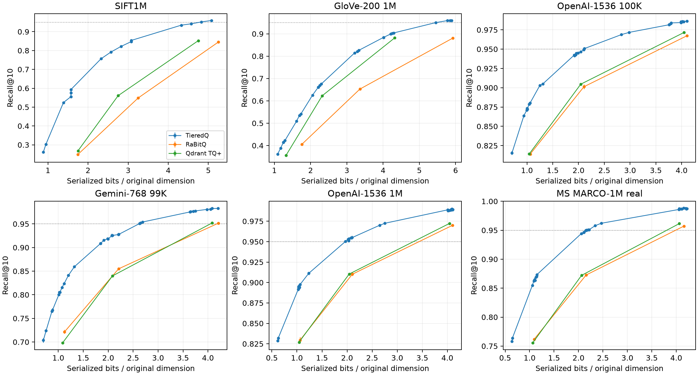

# TieredQ: Variance-Aware Bit Allocation

TieredQ is a new vector quantization algorithm that dynamically allocates bits per dimension, providing high recall compression ratio. TieredQ centers and rotates vectors into a PCA basis, then greedily allocates 0–8/12 bits per dimension to reduce quantization error. TieredQ provides same recall per bit at about 36–52% less RAM & disk usage (in low bit budgets like 1,2,4 bits per dimension) compared to RaBitQ and TurboQuant. ANN indexes (f.e. IVF / HNSW) can use the codec to save RAM and disk space (reference IVF_TieredQ implementation is provided).

TieredQ core algorithm:
1. PCA
2. Variance-aware greedy bit allocation per dimension (principal component)
3. Scalar quantization per dimension with allocated bit budget

[blog post](https://seanpedersen.github.io/posts/tieredq/)

Recall per bits used:


[Final benchmark report](docs/benchmark-report.md)

## Install

Install [TieredQ from PyPI](https://pypi.org/project/tieredq/):

```sh
uv add tieredq
# or: pip install tieredq
```

## Python

```python
import gensim.downloader as api
from tieredq import TieredQIndex

vectors = api.load("glove-wiki-gigaword-100").vectors  # (400000, 100), float32
d = vectors.shape[1]
index = TieredQIndex(dimensions=d, code_bits=2 * d)  # 2 code bits per dimension
index.add(vectors)  # first add trains (a seeded 32,768-row sample of larger batches); later adds only encode
scores, ids = index.search(vectors[:2], k=10)  # (2, 10) float32, uint32

index.save("index.tq")
index = TieredQIndex.load("index.tq")
```

`gensim` is needed only for this example (`uv add gensim`). Constructor options
after `code_bits` are keyword-only:

| Parameter | Default | Meaning |
| --- | --- | --- |
| `dimensions` | required | Input vector width. |
| `code_bits` | required | Total code-bit budget per vector, from 1 to `8 * dimensions`; excludes metadata and storage padding. After training, `index.code_bits` reports the realized allocation. |
| `mode` | `"fast"` | `"fast"` for native search storage; `"full"` for compact packed rows. |
| `metric` | `"ip"` | `"ip"`, `"cosine"`, or `"l2"`. |
| `allocation_power` | `None` | Metric- and budget-dependent variance power; a positive finite value overrides it. |
| `exact_fast_scores` | `False` | Train Lloyd-Max codebooks and use exact FP32 scoring of quantized codes. |
| `max_scan_bits` | `0` | Per-coordinate scan cap, 1–8; 0 selects the automatic cap described below. |
| `fine_tiers` | `True` | Enable fine tiers for fast ip/cosine indexes; ignored in full mode and for L2. |
| `max_tier_bits` | `12` | Per-coordinate total width cap for fine tiers, 1–12; does not increase the total `code_bits` budget. |

- `metric="ip"` (inner product) is the default; `metric="cosine"` normalizes rows and
  queries, and `metric="l2"` serves Euclidean search with scores of `-|q - x|^2`.
  L2 lifts vectors into one extra dimension with a lift whitened for the query
  distribution, stored in the model, so saved indexes stay self-contained.
- Bit allocation follows the metric: inner-product and cosine models allocate
  on PCA variance^1.5 at budgets of at least 1 bit/dim (recall-optimal when queries are distributed like the data,
  +0.5 to +0.8 R@10 points at equal disk on DBpedia OpenAI/Gemini, GloVe neutral to
  +1.3, issue #9) in both modes; L2 models use variance (MSE), which is optimal for
  whitened queries. For ip/cosine budgets below 1 bit/dim, the power falls linearly
  to 1 at 0.5 bits/dim and stays at 1 below that.
  `allocation_power=` overrides it on `TieredQIndex`.
- `mode="fast"` is the default and stores the native fast search representation. Models with tiers above 4 bits score
  through approximate byte tables (L2 models keep exact FP32 scoring); `exact_fast_scores=True` trains Lloyd-Max
  books and scans them in exact FP32 instead. That is the batch-throughput option: at 8 bits/dim on AVX-512 (100k,
  ip) batch search ran about 2x faster than the byte tables at equal recall on Gemini-768 and OpenAI-1536 (with its
  fine tiers, below) and better recall on GloVe-200, while single-query latency was 2-3x higher (4-10x on NEON and AVX2;
  #31).
  Use `mode="full"` for compact packed rows and FP32 scoring of quantized vectors,
  with slower search. Both modes scan every vector; saving and loading preserve
  the selected representation. Read the selection from `index.mode`.
  The former `fast_mode` boolean argument/property has been removed; use `mode`.
- Fast ip/cosine indexes use fine tiers by default (#26, #31): ranks coded with up to `max_tier_bits=12` bits at the
  same bytes, whose top bits are an ordinary fast code at the automatic cap (6 bits, or ceil(bits/dim) when larger).
  `max_scan_bits` overrides that cap; fine tiers require a cap of at least 6 bits.
  The scan reads only those prefixes, then rescores max(24, 1.5·k) candidates exactly. Training uses them whenever the
  allocation codes a rank wider than the prefix; `fine_tiers=False` disables them, and `index.fast_prefix_bits` is the
  prefix width (0: none). 100k vectors, mean missed top-10 hits over 3 seeds, fine tiers vs none: Gemini-768 66 → 15,
  OpenAI-1536 44 → 6 at 8 bits/dim; 209 → 171 and 168 → 115 at 4 bits/dim; GloVe-200 162 → 87 at 8 bits/dim and
  unchanged at 2-4 (no rank goes wide). Batch QPS vs fine tiers off (100k, #31): +5-6% at 8 bits/dim and -4% to -8% at
  3-4 bits/dim for k=10; -5% to -7% at 8 and -22% to -27% at 3-4 bits/dim for k=100 (rescoring 150 candidates). On
  1M sets (OpenAI-1536, MS MARCO Cohere-1024, 6-8 bits/dim) top-10 misses fell 46-79% and search got 3-24% faster (likely
  as the scan reads fewer bits); encoding is 11-34% slower (wider codes). With `exact_fast_scores=True` the prefix is the
  8-bit Lloyd-Max code, scanned exactly, and fine bits refine its cells: at 8 bits/dim mean top-10 misses fell from 28 to
  15 (Gemini-768) and 18 to 9 (OpenAI-1536) at the same batch speed. The flat `TieredQIndex` and `TieredQIVFIndex` serve
  fine-tier models (opt in with `fine_tiers=True` on Python IVF; it defaults to `False` there). IVF scans the probed
  lists to the same candidate depth and rescores those candidates. Train nested
  prefix models with `TieredQConfig::fine_tiers = false` (the Python nested index does).
  Nested suffix refinement can independently opt into wider codes with `fine_tiers=True`.
- In C++, use `tq::TieredQIndex(codec)` for fast mode or
  `tq::TieredQIndex(codec, tq::TieredQIndexMode::full)` for full mode.
  Inspect the enum with `index.mode()`; the boolean constructor is removed.
- The first `add()` needs a representative batch of at least two vectors.
  Inputs must be contiguous float32 NumPy arrays.
- Queries accept one vector or a matrix. Scores estimate the selected metric:
  inner product, cosine similarity, or negative squared Euclidean distance; larger is better.
- Fast storage size depends on the model and CPU. Inspect `bytes_per_vector`
  for the representation stride and `storage_bytes` for allocated vector data.
  Fast scans use AVX-512 or AVX2+F16C on x86, and NEON on ARM.
  On AVX-512, single-vector queries with compatible packed-code models use a
  range checkpoint after four tiers to skip uncompetitive suffixes while preserving
  fast-scan IDs and score bits. Bounds are prepared per query and add no stored bits
  per vector. Other layouts, backends, and multi-vector queries use the full scanner.
- Matrix queries use OpenMP workers. Set `OMP_NUM_THREADS` before starting Python
  to control parallelism.
- `mode` also steers training. Fast models whose tiers all fit 4 bits use an additive
  3-bit codebook, so the x86 nibble lookup stores 3-bit tiers at exactly 3 bits.
  This adds +1.2 to +3.6 R@10 points on GloVe-200 at 2.25–3.9 bits/dim, at equal
  storage and speed. It is neutral on SIFT, and DBpedia OpenAI/Gemini at 2–4 bits/dim
  are unchanged. Full mode keeps the Lloyd-Max 3-bit codebook, and either model
  serves in either mode. See [issue #20 results](benchmark/results/issue20-additive-20261029/README.md).

See [fast-mode measurements](docs/glove200-fast-scan.md) for accuracy and speed.
Models with tiers wider than 4 bits now retain original codebook precision in fast mode.
This improves recall at a throughput cost; existing numerical-level fast indexes
need rebuilding to recover that precision. Their fast storage keeps codes at tier
width; files saved with the earlier one-byte-per-coordinate layout still load and are
repacked. See the [high-bit investigation](docs/high-bit-recall.md).

### IVF and nested search (Python)

```python
from tieredq import TieredQIVFIndex, TieredQNestedIVFIndex, TieredQPruning

d = vectors.shape[1]
queries = vectors[:2]
ivf = TieredQIVFIndex(dimensions=d, code_bits=2 * d)  # lists from the row count; lists=0: one per codec centroid
ivf.build(vectors)  # trains the codec (seeded 32,768-row sample) and the lists, then indexes
scores, ids = ivf.search(queries, k=10, nprobe=32)

# Low-RAM nested index (the defaults): 1-bit prefix codes in an in-RAM IVF, candidates rescored with an 8-bit tier on SSD.
index = TieredQNestedIVFIndex.build(vectors)
index.write_tier("tier.rows", vectors)  # or index.attach_tier(index.encode_tier(vectors)) to keep it in RAM
index.attach_tier("tier.rows", reads="direct")  # 32 reads in flight
scores, ids = index.search(queries, k=10, nprobe=128)  # 40 candidates by default
index.save("nested.tq")  # IVF, refinement and tier layout; attach the tier again after load()
```

Which index (#27; VIBE arxiv 1.34M × 768 and Qwen 8.84M × 1024, one core):

| Need | Index | Why |
|---|---|---|
| Lowest RAM, or recall above about 0.95 | `TieredQNestedIVFIndex` defaults (tier on SSD) | Only the 1-bit prefix is in RAM. It reaches recall@10 0.97-0.998 at 1.3-2.6 ms on arxiv, 0.99 at 8.84M |
| Latency first, recall within flat's ceiling, RAM to spare | `TieredQIVFIndex` at the fewest bits/dim that reach the target | No SSD reads and about 2× nested's QPS, but recall stops near 0.955 at 1.75 bits/dim (arxiv) |

#### Low-RAM recipe (large sets)

`TieredQNestedIVFIndex.build` defaults to the configuration that won on recall per GB of serving RAM on
Qwen/MS MARCO 8.84M × 1024 (#49, #52). A base kept as an SQ8 store (int8 codes with per-dimension scales and offsets,
e.g. 9 GB instead of 36 GB of float32) builds from a memory map, decoded a chunk at a time:

```python
import numpy as np
from tieredq import TieredQNestedIVFIndex

codes = np.memmap("base.i8", dtype=np.int8, mode="r").reshape(-1, 1024)
store = dict(codes=codes, scales=np.fromfile("scales.f32", np.float32), offsets=np.fromfile("offsets.f32", np.float32))
index = TieredQNestedIVFIndex.build(**store)       # vector = codes * scales + offsets; same index as the float rows
index.write_tier("/nvme/tier.rows", **store)
index.save("nested.tq")
index.attach_tier("/nvme/tier.rows", reads="direct")
scores, ids = index.search(query, k=10, nprobe=192)
```

What the defaults pick (each is a keyword of `build`):

| Setting | Default | Notes |
| --- | --- | --- |
| `prefix_bits` | 1 per dimension | in RAM; `max_scan_bits=0` caps its scan at 4 bits (nibble kernels) up to 2 bits/dim |
| `lists` | `None`: automatic | 2K at 1M rows, 64K at 8.84M (`TieredQIVFIndex::automatic_lists`); `0` keeps one list per codec centroid |
| `coarse_training` | `None`: automatic | from 8,192 lists: 4 Lloyd iterations on 40 rows/list, 256 × 16 restricted assignment |
| `router` | `None`: automatic | the two-level router from 8,192 lists; `True`, `False` or a `TieredQRouterConfig` |
| `total_bits` | 8 per dimension | the tier: `fine_tiers=True` (up to `max_tier_bits=12`), `tier_rows="suffix"` |
| `candidates` (search) | 40 | `max(40, 2k)`; the 1-bit prefix lost about 0.005 recall@10 at 20 reads; at k = 100, 200 matched 400 |

Measured on 8.84M × 1024 (one pinned core, tier on NVMe with direct reads, 40 candidates): 2.03 GB anonymous RSS,
about 290 s to build on 32 threads, recall@10 0.944 / 0.951 / 0.963 / 0.968 / 0.977 / 0.984 / 0.991 at 2.2 / 2.4 /
2.9 / 3.4 / 5.1 / 8.4 / 22 ms (nprobe 96-1024, 4096). The 2-bit prefix (`prefix_bits=2 * d`, `candidates=20`) reaches
the same recall at 3.35 GB and 2.4-11.6 ms. Faiss IVF-SQ8 with an HNSW quantizer at 128K lists needs 13.6 GB and
3,052 s; against it the 2-bit prefix was level at 0.95 and 1.16-1.6× faster from 0.963 to 0.99, and the 1-bit prefix is
another 15-28% faster. Built and served through Python with these defaults only (an SQ8 memmap in, the tier on
NVMe), the 1-bit index takes about 310 s and serves in 1.58 GB (1.72 GB before the heap fixes and packed lists; an ABBA
shows no build-time change). On the same index Python's p50 is within 2.3% of C++, and 32 threads give 3,746 /
1,068 / 360 QPS at recall@10 0.938 / 0.980 / 0.990. This index measured 6-10% slower, at 0.003-0.007 lower recall,
than the seed-42 index quoted above (another day and host state; not resolved)
([SSD tier study](ann-prototypes/geometry_ann/results/hartmut-ssdtier-20261111/README.md),
[defaults study](ann-prototypes/geometry_ann/results/hartmut-defaults-20261111/README.md),
[Python end to end](ann-prototypes/geometry_ann/results/hartmut-pythondefaults-20261111/README.md),
[Python against C++](ann-prototypes/geometry_ann/results/hartmut-quiethost-20261111/README.md),
[tier-write A/B](ann-prototypes/geometry_ann/results/hartmut-tierwrite-20261111/README.md)). When SQ8 recall matters
more than RAM, keep a 6-bit tier in RAM and add `attach_exact` over SQ8 rows on SSD (7.84 GB).
`build` and `write_tier` also take `loader=` (a callable from `uint32` ids to float32 rows) with `count=` (and
`dimensions=` for `build`).

- `TieredQIVFIndex(dimensions, code_bits, *, lists=None, metric="ip", fine_tiers=False, max_scan_bits=0,
  coarse_training=None, router=None)` always uses fast storage. `build(rows)` (or `build(codes=, scales=, offsets=)`,
  or `build(loader=, count=)`) replaces its vectors; only the first `build` or `train_lists(sample)` trains the codec.
  `lists=None` picks the count from the first build's rows as the nested index does (2K at 1M, 64K at 8.84M; one list
  per codec centroid below about 143K rows); `lists=0` always keeps the codec's centroids. Call `train_lists` (with an
  explicit `lists`) before `build` to fix the partition on a separate sample. From 8,192 lists the index trains
  them fast and builds the router unless `coarse_training` or `router` say otherwise (see Many lists below).
  `max_scan_bits=0` caps the scan at 4 bits up to 2 bits/dim (without fine tiers), as the bit-cap note below measures.
  In C++ the caller trains the codec: `TieredQIVFIndex::automatic_scan_bits(config)` and `automatic_lists(rows)` give
  the same choices.
- `TieredQNestedIVFIndex.build(vectors=None, *, codes=None, scales=None, offsets=None, loader=None, count=None,
  dimensions=None, prefix_bits=None, total_bits=None, lists=None, metric="ip", tier_rows="suffix", sample=None,
  fine_tiers=True, max_tier_bits=12, max_scan_bits=0, coarse_training=None, router=None)` trains a nested index
  (defaults in the table above). `prefix_bits` and `total_bits` are budgets per vector, with the prefix included
  in `total_bits`. For inner product/cosine, `fine_tiers=True` lets suffix training allocate
  combined prefix/suffix codes wider than 8 bits, up to `max_tier_bits` (8–12).
  The IVF prefix stays fixed; candidates are rescored directly with all suffix bits.
  `max_refinement_bits` reports the widest realized code;
  `total_bits` and `tier_bytes_per_vector` report realized storage after block rounding.
  Wider suffix models use refinement format 2; existing format 1 models still load.
  In a [local Gemini-768 benchmark](benchmark/results/nested-fine-local-20261105/README.md),
  an 8-bit/dimension total budget improved full-probe recall@10 from 99.44% to 99.76%
  (57% fewer misses), with median batch time per query changing from 2.480 to 2.501 ms
  on one M1 thread with a RAM tier. The 4-bit/dimension control was unchanged.
  Neither IVF constructor exposes the flat index's `mode`, `allocation_power`, or `exact_fast_scores`.
- `index.attach_exact(codes_or_path, scales, offsets, finals=16)` adds the exact SQ8 final stage (int8 codes in RAM,
  or a `TieredQNestedIVFIndex.write_sq8_rows(path, codes)` file with `reads="direct", queue_depth=32` on SSD);
  `detach_exact()` removes it.
- IVF searches require keyword `nprobe`; nested searches take `candidates >= k` (default `max(40, 2k)`). Results use
  `2**32 - 1` ids and `-inf` scores for slots beyond the rows in the probed lists.
- File tiers default to `reads="cached"`, with 1 read in flight (32 with `reads="direct"`). Concurrent reads at
  larger queue depths require a build with liburing; otherwise reads stay serial.
  PyPI wheels disable liburing.
- One `build` trains the prefix, the lists and the refinement from the same seeded sample, so they cannot be
  mismatched. Pass `sample=` to train on earlier data instead; its rows also fix the lists for later builds (as
  `TieredQIVFIndex.train_lists` does).
- `tier_rows="suffix"` (the default) stores a smaller tier and decodes each candidate's prefix from the lists;
  `"prefix_and_suffix"` reads each candidate in one row (see the C++ notes).
- Tier rows kept in another store (a database, an object store): `ids = index.candidates(queries, 50, nprobe=64)`,
  fetch the `encode_tier` rows of those ids (shape `ids.shape + (index.tier_bytes_per_vector,)`; ids of
  `2**32 - 1` are padding), then `scores, ids = index.rescore(queries, ids, rows, k=10)`.
- `pruning=TieredQPruning(confidence=8)` opts IVF and nested scans into approximate pruning (see below).
- Many lists: from 8,192 lists an index trains them with 4 Lloyd iterations on 40 sample rows per list and restricted
  assignment (256 supers, 16 probes), and builds the two-level router (`ivf.coarse_training`, `ivf.has_router`).
  `coarse_training=TieredQCoarseTraining(...)` or `ivf.set_coarse_training(iterations=20, assignment_supers=0, ...)`
  sets another training; `router=False` or `ivf.remove_router()` drops the router, and `router=TieredQRouterConfig(...)`
  or `ivf.build_router(...)` configures it. `search(..., routing="auto" | "router" | "exact", super_probes=0)` selects
  the coarse ranking (see the C++ notes on many lists).

## C++

Building from source requires CMake 3.18+, a C++20 compiler, OpenMP, and
BLAS/LAPACK. liburing is optional for concurrent SSD tier reads.

```sh
cmake -S . -B build
cmake --build build -j
OMP_NUM_THREADS=2 ctest --test-dir build --output-on-failure
./build/tieredq_example
cmake --install build --prefix /desired/prefix
```

Include `<tieredq/tieredq.h>`, use `find_package(TieredQ CONFIG REQUIRED)`, and
link `TieredQ::TieredQ`. FetchContent also works. See [integration.md](integration.md)
for layouts, threading, ownership and dependency setup.

`tq::TieredQ::train(config, sample, rows, seed)` trains on a contiguous sample. To train on part of a larger
array without copying it, `tq::TieredQ::train_sampled(config, data, count, sample_ids, sample_rows, seed)` reads
the named rows in place (the same model). About 8–16K training rows reach full recall on 1M-row sets; fewer than
~32 rows per centroid lose recall ([#19.2 results](benchmark/results/issue19-drift-20261031/README.md)).

### IVF (C++)

`tq::TieredQIVFIndex` is a fast-mode inverted-file index. With `lists = 0` the codec's k-means centroids
(at most 256) are the lists, at no extra storage. Any other count trains a separate coarse quantizer, whose
centroids are stored.

```cpp
tq::TieredQIVFIndex index(codec, /*lists=*/1024);
index.train_lists(sample, sample_rows);  // optional: fix the lists on a sample; builds then only assign rows
index.build(rows, count);
auto hits = index.search(query, /*k=*/10, /*nprobe=*/16);
// Opt-in approximate pruning for models with more than four tiers (about 2+ bits/dim):
auto fast = index.search(query, 10, 16, tq::TieredQPruning{/*confidence=*/8, /*prefix_tiers=*/4});
```

- **Layout and memory.** Lists are packed back to back (payload version 6, #53). A scan starts each list on the
  32-document boundary at or below its first row and skips the previous list's rows there, so no list is padded. Files
  of versions 2-5, where each list was padded to 32 documents with copies of its last row, still load, and they keep
  that layout and version when saved again. `build()` and `write_tier()` return freed heap to the OS after their
  buffers are gone. Encoding workers use buffers that the calling thread allocates, because glibc never trims a worker
  arena's free top (#43, #41). `storage_bytes()` counts the codes, the codec (with its encoder state once built), the
  coarse centroids, the router, the list offsets and the ids. `TieredQNestedIVFIndex::storage_bytes()` adds the
  refinement and the id → document map. On VIBE arxiv (k = 100) the nested default's USS growth fell from 0.241 to
  0.178 GiB ([study](ann-prototypes/geometry_ann/results/hartmut-nestedram-20261111/README.md),
  [heap attribution](ann-prototypes/geometry_ann/results/hartmut-heapretention-20261111/README.md)).
- **Many lists (64K+).** `set_lists(centroids)` fixes the lists to a partition trained elsewhere.
  `build(RowLoader, count)` pulls rows by id in bounded chunks, so a base held as SQ8 codes needs no fp32 copy.
  From `TieredQCoarseTraining::fast_lists` (8,192) lists an index trains its lists with 4 Lloyd iterations on 40
  sample rows per list and restricted assignment over 256 supers × 16 probes, and builds the router at its defaults
  (`TieredQRouterConfig::automatic_lists`, 8,192). Fewer lists keep 20 iterations, exact assignment and 64 rows per list.
  On Qwen 1M × 1024 the fast training stayed within 0.002 recall@10 of the exact recipe from recall 0.93 up at 8K-32K
  lists for 25-43× less training time, and the router was faster than exact ranking from 8K lists (#52).
  `set_coarse_training({iterations, assignment_supers, assignment_probes, sample_rows_per_list})` overrides the
  training, and `remove_router()` opts out of the router. In restricted assignment (#48) each row is assigned among the members of its
  `assignment_probes` nearest supers, a k-means of the lists' centroids. Rows whose nearest list lies in a probed
  super get the exact label, up to floating-point near-ties. Exact assignment runs as FP32 BLAS `sgemm`, as in
  Faiss; query ranking keeps the binary16 panels. On Qwen 1024-D (500K rows, 32K lists), 256 supers and 16 probes kept 99.0%
  of exact labels and ran 8.5× faster.
  Exact coarse ranking streams every centroid per query: about 9 ms at 64K × 1024. `build_router()` adds a two-level
  compressed router (#47). It ranks about lists/128 supers exactly, scans the 2-bit TieredQ codes of
  the probed supers' member centroids, and re-ranks the first 64 lists exactly (`rerank`; 256 cost 0.1-0.3 ms per query
  at 64K lists without recall above 0.945). The probed supers grow with `nprobe`.
  Batches route too: at 64K lists, 32-thread batches through the router reached 1.4× the QPS of the exact GEMM ranking.
  `TieredQRouting{mode, super_probes}` forces either path
  or the number of probed supers per search. The router persists with the index (payload version 6, or 5 for an index
  loaded with padded lists).

  ```cpp
  tq::TieredQIVFIndex index(codec, /*lists=*/65536);  // trains fast ({4, 256, 16, 40}) and routes by default
  index.set_lists(centroids);  // optional: a partition trained elsewhere
  index.build(loader, count);  // the router is rebuilt by every later build()
  auto hits = index.search(query, 40, /*nprobe=*/256);
  auto exact = index.search(query, 40, 256, {}, {tq::TieredQRouting::Mode::exact});
  ```
- **Pruning.** By default the scan prunes exactly: hits equal an unpruned scan. A positive `confidence`
  bounds the remaining tiers statistically instead, which is faster and approximate. On OpenAI 100k, confidence 8
  kept recall unchanged (±0.0001) at 1.7× the QPS at 4 bits/dim. With `prefix_tiers = 3` it gave 1.6–2.4× the QPS
  for 0.001–0.003 recall at 2 and 4 bits/dim. Confidence 4 or less loses clearly more recall.
  Platforms: the exact FP32 code scan prunes on AVX-512 only. The nibble byte-table scan (default fast models with
  tiers above 4 bits) prunes on AVX-512, AVX2 and NEON. The scalar fallback validates the setting and scans unpruned.
  By default (`prefix_tiers = 0`, automatic) a nibble scan prunes after all but the last 12.5% of its sections
  (37.5% with a positive confidence), or after the first four tiers where those leave more; an explicit
  `prefix_tiers` prunes after that many tiers. Single-core, 100k documents, 256 lists, on Apple M1 (NEON), EPYC Milan
  (AVX2) and i9-7980XE (AVX-512) with 384-, 768-, 1024- and 1536-d embeddings: exact pruning returned the unpruned
  hits in every run and was 1.0–1.3× faster than unpruned at nprobe 64–256 (about 1.0× at nprobe 16); confidence 8
  was 1.0–1.8× faster with unchanged recall@10. Flat single-query search prunes the same way, 1.0–1.2× faster except
  Gemini-768 at 2 bits/dim, 5–18% slower. Larger suffix shares lose with the exact bound, which loosens faster than it
  saves work.
  To prune through the exact FP32 scan instead, train with `TieredQConfig::target_mode = TieredQIndexMode::full` and
  `fine_tiers = false` (flat Python `exact_fast_scores=True, fine_tiers=False`; Python IVF does not expose the
  exact-scoring training option). Measured at 4 bits/dim, before nibble scans were pruned: on OpenAI-1536 100k
  exact with confidence 8 was 4–11% faster than nibble scoring at equal or slightly higher recall, and on OpenAI 1M
  17–21% faster but 0.4 pt R@10 lower; on Gemini-768 nibble scoring was 20–38% faster, at 0.2 pt R@10 lower. At
  2 bits/dim nibble scoring was faster on both (#13).
- **Bit cap.** At about 2 bits/dim or less, training with `TieredQConfig::max_scan_bits = 4` keeps every tier on the
  nibble lookup kernel. That gave 1.7× RaBitQ's IVF QPS at equal recall and memory (OpenAI 100k), for about
  0.006 recall at full probe. Don't use it at 4 bits/dim, where it loses recall.
- **Sub-1-bit index + rerank.** With rerank, the in-RAM IVF code can be far below 1 bit/dim. On OpenAI-1M (256
  lists), a 512-bit prefix (627 index bits/vector) with an INT8 rerank tier reached R@10 0.95 / 0.99 at 2.8x / 3.1x
  the QPS of RaBitQ 1 bit (1,683 bits) + INT8.
- **Nested rerank codes.** `tq::TieredQRefinement` (`<tieredq/tieredq_refinement.h>`) trains a suffix that refines
  the prefix towards a finer model. The suffix is read by id for the scan's candidates and scored with the scan's query
  weights; nesting costs about no recall against a flat code of the full width:

  `tq::TieredQNestedIVFIndex` (`<tieredq/tieredq_nested.h>`) serves this end to end. The prefix codes stay in the
  in-RAM IVF lists. Each candidate's tier row is read by id from a `TieredQRowSource`: `TieredQMemoryRows` in RAM,
  `TieredQFileRows` with one `pread` per candidate on SSD (`TieredQFileReads::direct` bypasses the page cache), or your
  own store. `TieredQTierRows::prefix_and_suffix` stores the prefix row and the suffix (one contiguous read). The
  default, `TieredQTierRows::suffix`, stores only the suffix and decodes each candidate's prefix from the IVF lists
  (`TieredQIVFIndex::document_rows`). That tier
  is smaller (651 vs 784 B/vector at a 1024-bit prefix, d = 1536) but costs about 3.4 us of decoding per candidate and
  a 4-byte id-to-document map in RAM.

  ```cpp
  // Train the prefix on the same sample and seed as the refinement, with fine tiers disabled.
  auto config = tq::TieredQConfig::target_code_bits(d, d);
  config.fine_tiers = false;
  auto codec = tq::TieredQ::train(config, sample, rows, seed);
  auto refinement = tq::TieredQRefinement::train(codec, /*total_code_bits=*/4 * d, sample, rows, seed,
                                               /*fine_tiers=*/true, /*max_tier_bits=*/12);
  tq::TieredQIVFIndex ivf(codec);
  ivf.build(data, n);
  tq::TieredQNestedIVFIndex index(std::move(ivf), std::move(refinement), tq::TieredQTierRows::prefix_and_suffix);
  tq::TieredQRowFileWriter writer("tier.rows", index.tier_bytes_per_vector());
  std::vector<uint8_t> buffer(chunk * index.tier_bytes_per_vector());
  for (size_t first = 0; first < n; first += chunk) {        // ids in build order
    const size_t count = std::min(chunk, n - first);
    index.encode_tier(data + first * d, first, count, buffer.data());
    writer.append(buffer.data(), count);
  }
  writer.finish();
  index.attach_tier(std::make_shared<tq::TieredQFileRows>("tier.rows"));
  auto hits = index.search(query, /*k=*/10, /*nprobe=*/32, /*candidates=*/50);
  ```
  `TieredQNestedIVFIndex::build(TieredQNestedConfig, loader, count)` does all of the above with the low-RAM defaults
  (1-bit prefix with a 4-bit scan cap, automatic lists, fast list training and router, 8-bit fine suffix tier,
  suffix-only rows; see the Python table), from a `RowLoader`. `sq8_row_loader` decodes an SQ8 store in memory, e.g. a
  memory-mapped base, so no float copy is made:

  ```cpp
  auto rows = tq::sq8_row_loader(codes, n, scales, offsets);  // codes: n x d int8, row = codes * scales + offsets
  tq::TieredQNestedConfig config;
  config.dimensions = d;                                      // other fields: 0 or unset picks the default
  auto index = tq::TieredQNestedIVFIndex::build(config, rows, n);
  index.write_tier("/nvme/tier.rows", rows);
  index.attach_tier(std::make_shared<tq::TieredQFileRows>("/nvme/tier.rows", tq::TieredQFileReads::direct, 32));
  auto hits = index.search(query, /*k=*/10, /*nprobe=*/192);  // 40 candidates
  ```
  An exact final stage (`attach_exact`) rescores the tier's best `finals` candidates with exact vectors, e.g. an SQ8
  store left on SSD (`TieredQSQ8Rows` over a `TieredQFileRows` of int8 codes, direct reads, queue depth 32). On Qwen
  8.84M × 1024 at 64K lists, a 6-bit fine tier in RAM plus 16 exact SQ8 rows per query from NVMe matched the in-RAM SQ8
  re-rank's recall at every nprobe (0.954-0.986) with 7.8 GB of serving RAM instead of 12.2 GB, for about 0.7 ms per
  query ([hybrid study](ann-prototypes/geometry_ann/results/hartmut-hybrid-20261111/README.md)).

  ```cpp
  index.attach_exact(std::make_shared<tq::TieredQSQ8Rows>(
      std::make_shared<tq::TieredQFileRows>("sq8.rows", tq::TieredQFileReads::direct, /*queue_depth=*/32),
      scales, offsets), /*finals=*/16);
  ```
- **Flat nested search.** `tq::TieredQNestedIndex` (`<tieredq/tieredq_nested_flat.h>`) scans a narrow prefix for
  every document and rescores the top candidates with an in-RAM suffix tier (a one-list `TieredQNestedIVFIndex`). On
  OpenAI-1536 it is the fast flat path from about 3 bits/dim. A 512-bit prefix with a 3 bits/dim total tier reached
  RaBitQ's 4-bit recall at 2.2x (100K, 50 candidates) and 2.9x (1M, 100 candidates) its single-query QPS, with
  0.76-0.79x its stored bits. The plain flat index is at 0.54x there.

  ```cpp
  auto config = tq::TieredQConfig::target_code_bits(d, 512);
  config.fine_tiers = false;
  auto prefix = tq::TieredQ::train(config, sample, rows, seed);
  auto refinement = tq::TieredQRefinement::train(prefix, /*total_code_bits=*/3 * d, sample, rows, seed);
  tq::TieredQNestedIndex index(std::move(prefix), std::move(refinement), data, n);
  auto hits = index.search(query, /*k=*/10, /*candidates=*/100);
  ```

  `serialize()` stores the IVF, the refinement and the tier layout; after loading, attach the tier again. For a
  tier in an external store, run `index().search_batch` for the candidates and `rescore_batch` with their fetched
  tier rows; it needs no attached tier.

  At 1M, 512 / 768 bit prefixes + a 4-bit refinement (about 700 B/vector) beat RaBitQ's own 5/6-bit codes by 1.2-2.4x
  QPS at R@10 0.95-0.98 with 28-43% fewer rerank bytes. Refinement recall tops out near 0.984; above that use INT8.
- **Results** against RaBitQ's IVF at equal measured memory are in
  [issue #19](https://github.com/SeanPedersen/TieredQ/issues/19), [#23](https://github.com/SeanPedersen/TieredQ/issues/23)
  and the [issue #6 eval](benchmark/experiments/issue6_ivf/ivf_eval.cpp)
  ([rerank results](benchmark/results/issue6-ivf-rerank-20261030/README.md)).

## Codec comparison benchmark

See [benchmark/README.md](benchmark/README.md) for the one-command CPU comparison
against official RaBitQ on SIFT1M, GloVe-200 and OpenAI3-1536, including measured
storage overhead, recall, throughput and latency.

Disclaimer: everything but the core idea and the README was created using both Opus 5.5 and GPT 6.1 Sol
