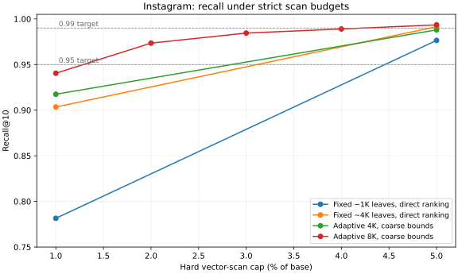

# Instagram embedding pilot — 2026-11-06

Implemented V0, V1, and V2, then tested the explicit requirement to scan only a small fraction of the corpus. The final adaptive configuration reaches **0.9735 recall@10 within a hard 2% vector cap** and **0.9935 within 5%** on this query set. It does **not** yet establish the intended limited-traversal or latency advantage: it evaluates nearly all 8K partition descriptors, and HNSW is substantially faster.

## Final bounded-scan result

455,266 base vectors × 1,024 dimensions, 200 held-out queries. FP32 coordinates, squared L2, no normalization. Source is the user-selected `~/projects/vector-db-benchmark/instagram_vectors.npy` (455,466 × 1,024, float64). Original embedding model and retrieval objective are unverified. Seed 42; source stat, query source-row IDs, and exported-file SHA256 hashes are recorded in `manifest.json`. Exported vectors and exact truth are in `/tmp/geometry-instagram-20261106/`, outside version control.

Final V1 settings: 64 requested coarse groups, 8,192 adaptive leaves, target leaf size 32; sampled two-means splitting, four Lloyd iterations, at most 4,096 training samples per clustering call. Coarse parents use radius lower bounds; leaves use centroid ordering. Build **33.1 s**, raw vectors **1.865 GB**, owned index overhead **36.98 MB** (1.98% of raw bytes). Process high-water RSS at build completion was 4.05 GB; it includes input vectors and runtime, not just index allocations.

| Hard vector cap | Mean scanned | Recall@10 | p50 (ms) | p99 (ms) | Mean partition evaluations |
| --- | ---: | ---: | ---: | ---: | ---: |
| 1% (4,552) | 4,551.7 | 0.9405 | 7.04 | 8.65 | 8,255.8 |
| 2% (9,105) | 9,104.6 | 0.9735 | 9.07 | 19.81 | 8,255.8 |
| 3% (13,657) | 13,656.7 | 0.9845 | 10.24 | 15.93 | 8,255.8 |
| 4% (18,210) | 18,209.7 | 0.9890 | 11.36 | 14.69 | 8,255.8 |
| 5% (22,763) | 22,762.7 | 0.9935 | 12.50 | 16.00 | 8,255.8 |

The 1% cap misses 0.95 recall; the 4% cap misses 0.99. The smallest **tested** caps meeting the respective targets are 2% and 5%. These are measured pilot results, not guarantees on unseen queries.



Markers are measured settings; connecting lines are visual guides.

## What changed search work

| Experiment | Routing | Recall at 1% cap | Recall at 5% cap |
| --- | --- | ---: | ---: |
| Fixed ~1K, original | hierarchy | 0.6925 | 0.9500 |
| Fixed ~1K, direct leaf ranking | flat | 0.7815 | 0.9765 |
| Adaptive median 1K | flat | 0.6850 | 0.9265 |
| Adaptive median + PCA 1K | flat | 0.6850 | 0.9265 |
| Adaptive two-means 1K, original routing | hierarchy | 0.7180 | 0.9545 |
| Adaptive two-means 1K, coarse bounds | hierarchy | 0.8180 | 0.9780 |
| Fixed ~4K, direct leaf ranking | flat | 0.9035 | 0.9915 |
| Adaptive two-means 4K, coarse bounds | hierarchy | 0.9175 | 0.9880 |
| Adaptive two-means 8K, coarse bounds | hierarchy | 0.9405 | 0.9935 |

- Median-axis splitting was cheap but lost substantial recall on these embeddings. Local two-means produced better leaves.
- Comparing coarse centroid distances directly with fine centroid distances hid useful children. Prioritizing coarse parents by radius lower bound removed the measured routing gap for the tested adaptive configurations. Equal-bound parents expand before leaves; centroid distance breaks remaining ties.
- Increasing leaf count improved recall at the same **hard vector cap**. The ~4K fixed/direct-ranking diagnostic already reaches 0.9915 within 5%; the 8K adaptive result is not evidence that adaptation dominates fixed clustering.
- At 1K leaves, PCA added memory/build/query cost and did not improve the recall/work frontier. It was not retained in the 8K candidate. The 8K PCA configuration is unmeasured; no general claim about PCA on all partitions/datasets follows.
- Small vector work does not imply small metadata work. The final candidate still evaluates about 8,256 partitions per query. Radius/PCA pruning benefits need isolated matched-recall ablations; no graph has been added.

## Faiss references at recall thresholds

| Reference | Target | Measured recall | Work / corpus | p50 (ms) | p99 (ms) | Build (s) | Serialized overhead (MB) |
| --- | ---: | ---: | ---: | ---: | ---: | ---: | ---: |
| IVFFlat | 0.95 | 0.9710 | 2.66% | 2.53 | 91.41 | 8.4 | 7.84 |
| IVFFlat | 0.99 | 0.9960 | 10.08% | 13.46 | 50.88 | 8.4 | 7.84 |
| IVF + HNSW quantizer | 0.95 | 0.9715 | 2.63% | 1.73 | 17.31 | 60.4 | 8.12 |
| IVF + HNSW quantizer | 0.99 | 0.9905 | 5.11% | 2.55 | 138.63 | 60.4 | 8.12 |
| HNSW | 0.95 | 0.9615 | 0.19% | 0.63 | 1.40 | 180.5 | 123.88 |
| HNSW | 0.99 | 0.9930 | 0.80% | 1.26 | 1.97 | 180.5 | 123.88 |

IVF work counts scanned vector distances and excludes coarse quantization; HNSW work counts **distance evaluations**, not unique scanned rows. These reference work percentages are observations, not hard vector caps. IVF references use 1,024 lists, a 65,536-vector training sample and four clustering iterations; HNSW uses M=32 and construction ef=100. Faiss version is recorded in the dataset manifest. Reference scripts set OMP/BLAS thread limits to one and insert in 8,192-row batches.

Owned prototype overhead and serialized Faiss overhead are different measurements; neither includes raw-vector bytes. Do not treat serialized size as allocator RAM. The prototype and references also use different clustering budgets and kernels. Faiss latency includes Python API overhead; the prototype is timed directly in C++. All use exactly the same exported vectors, queries, metric and ground truth.

## Reproduce the final candidate

```sh
cmake -S ann-prototypes/geometry_ann -B /tmp/tieredq-geometry-build -DCMAKE_BUILD_TYPE=Release
cmake --build /tmp/tieredq-geometry-build -j 4
ctest --test-dir /tmp/tieredq-geometry-build --output-on-failure
/tmp/tieredq-geometry-build/geometry_bench \
  --base /tmp/geometry-instagram-20261106/base.fvecs \
  --queries /tmp/geometry-instagram-20261106/queries.fvecs \
  --truth /tmp/geometry-instagram-20261106/truth.ivecs \
  --nq 200 --coarse 64 --children 64 --leaves 8192 --target-size 32 \
  --variant V1 --split kmeans --ordering centroid --routing hierarchy \
  --leaf-scans 8192 --vectors 4552,9105,13657,18210,22763
```

Preparation, SIFT-style file support, other variants, metadata caps and Faiss commands are described in the parent [README](../../README.md). Regenerate the plot with `uv run --python 3.12 ann-prototypes/geometry_ann/plot_results.py ann-prototypes/geometry_ann/results/instagram-20261106`.

## Provenance and limits

Apple M1, 16 GiB RAM, Apple Clang 21.0.0, CMake Release. Sequential single-process runs, one process per built variant. Build includes clustering, metadata and packing/add, but excludes data loading, truth and serialization. Source preparation and index input buffers remain outside persistent-overhead accounting. CSVs retain process RSS high-water observations; RSS includes runtime/input and can be affected by macOS compression.

This is an exploratory single-run pilot with no confidence intervals or independent parameter-selection/test split. Two hundred queries provide only two observations in the upper 1% tail. Page residency, serialization before Faiss queries, cache state, thermal state and background load can affect latency; the initial p99 results are especially noisy. Recall and scan counts are more useful evidence here than small timing differences. Repeat on a fresh query split with controlled warmup before making production decisions.

Artifact chronology: `V0.csv`, `V1.csv`, `V2.csv` are the initial unrestricted leaf-budget sweeps with centroid-based parent ordering. `*-variance-caps.csv` and `*-kmeans-caps.csv` add hard 1%/5% vector caps before the coarse-priority correction. `V1-kmeans-coarse-bound-caps.csv` isolates the corrected coarse policy. `*-4096-caps.csv` tests smaller leaves. `V1-8192-caps.csv` is the final candidate, including immediate termination when its vector budget is consumed. `V1-8192-before-budget-stop.csv` preserves the preceding run: recall/work agree, but obsolete queue entries were unnecessarily processed after exhausting the cap. `V1-before-bound-tiebreak.partial.csv` is an interrupted diagnostic and is excluded from comparisons. Current source uses the corrected parent policy, so rerunning initial adaptive commands intentionally changes their routing results.

No point-level graph, shortcut graph, quantization, exact hull, or full per-leaf covariance matrix is implemented. The observed 5% vector-scan result is progress, not confirmation of the full statistical-bound/limited-traversal hypothesis.
