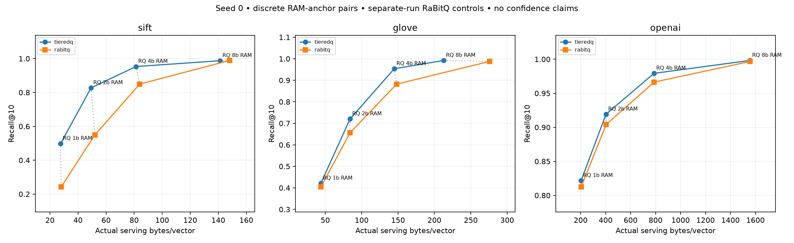
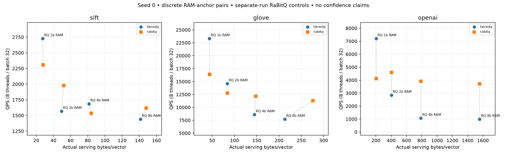
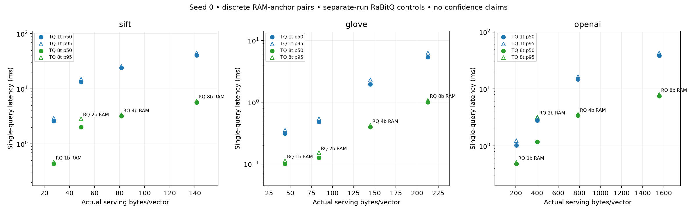

# Fast mode after the memory fix: calibrated RAM anchors

Full SIFT1M, GloVe-200 and OpenAI3-1536; seed 0, 1,000 held-out queries, CPUs 0–7 on hartmut (i9-7980XE, AVX-512BW). Threads 1/8 × batches 1/32, three warmup queries and three full timing repeats. **Single-seed run; no statistical-confidence claims.**

HEAD `06cda8574db318207fe577f55b4feca4c29a9995` regenerates narrow scaled-basis projection coefficients without changing codes or saved formats. Current C++ tests and all 16 benchmark validation tests passed before calibration. No kernel changes, profiling, normal mode, legacy lift, seed sweeps or optimization experiments were used.

## Paired discrete within-memory results

TQ / RQ denotes TieredQ / native RaBitQ. QPS is 8 threads/batch 32. Anchors retain the exact unrounded values from the archived CSV. RaBitQ results are **separate-run controls**, reused from `issue4-current-single-seed-20261026`; adapter, compiler, native bounds/HACC and benchmark protocol remain comparable. Background services remain active, so timing ratios do not isolate causal effects.

| Dataset | RQ bits | RQ anchor B/vector | TQ actual B/vector | Below anchor | Total code-bit budget | Recall TQ / RQ | QPS TQ / RQ | TQ build s | TQ encode vectors/s |
|---|---:|---:|---:|---:|---:|---|---|---:|---:|
| sift | 1 | 28.000624 | 27.573558 | 1.5252% | 129 | 0.4984 / 0.2429 | 2,727 / 2,307 | 1.698 | 1,504,605 |
| sift | 2 | 52.000624 | 49.329562 | 5.1366% | 320 | 0.8274 / 0.5493 | 1,568 / 1,976 | 2.216 | 875,052 |
| sift | 4 | 84.000624 | 81.343273 | 3.1635% | 569 | 0.9531 / 0.8493 | 1,686 / 1,535 | 3.637 | 387,938 |
| sift | 8 | 148.000624 | 141.346563 | 4.4960% | 1032 | 0.9876 / 0.9890 | 1,440 / 1,618 | 8.366 | 135,667 |
| glove | 1 | 44.012 | 43.887840 | 0.2821% | 210 | 0.4213 / 0.4049 | 23,315 / 16,371 | 0.553 | 829,906 |
| glove | 2 | 84.012 | 84.010720 | 0.0015% | 468 | 0.7203 / 0.6559 | 14,595 / 12,753 | 0.573 | 566,631 |
| glove | 4 | 148.012 | 144.791360 | 2.1759% | 1055 | 0.9536 / 0.8821 | 8,593 / 12,131 | 0.757 | 316,280 |
| glove | 8 | 276.012 | 212.797280 | 22.9029% | 1600 | 0.9921 / 0.9878 | 7,713 / 11,283 | 1.565 | 88,274 |
| openai | 1 | 204.0696 | 203.473520 | 0.2921% | 835 | 0.8217 / 0.8126 | 7,203 / 4,118 | 14.003 | 183,005 |
| openai | 2 | 404.0696 | 403.007040 | 0.2630% | 2048 | 0.9192 / 0.9041 | 2,847 / 4,589 | 14.568 | 84,705 |
| openai | 4 | 788.0696 | 787.800140 | 0.0342% | 5344 | 0.9793 / 0.9664 | 1,071 / 3,917 | 15.494 | 50,218 |
| openai | 8 | 1556.0696 | 1555.811140 | 0.0166% | 11488 | 0.9982 / 0.9967 | 992 / 3,710 | 22.065 | 12,628 |

Construction includes training, encode/pack and SIFT adapter fit/base transformation. Encode throughput times native add/encode/pack only. Single-query timings include query preprocessing, scan, top-k and binding.

## Single-query p50 / p95 milliseconds

| Dataset | RQ RAM anchor bits | TQ 1 thread | TQ 8 threads | RQ 1 thread | RQ 8 threads |
|---|---:|---|---|---|---|
| sift | 1 | 2.607 / 2.910 | 0.435 / 0.467 | 3.249 / 3.512 | 3.284 / 3.533 |
| sift | 2 | 13.247 / 14.892 | 2.016 / 2.846 | 3.965 / 4.586 | 4.023 / 4.657 |
| sift | 4 | 24.182 / 25.517 | 3.194 / 3.371 | 4.279 / 5.419 | 4.305 / 5.460 |
| sift | 8 | 40.527 / 44.576 | 5.658 / 6.006 | 4.362 / 5.771 | 4.418 / 5.811 |
| glove | 1 | 0.313 / 0.352 | 0.101 / 0.112 | 0.407 / 0.442 | 0.407 / 0.454 |
| glove | 2 | 0.482 / 0.540 | 0.126 / 0.152 | 0.515 / 0.610 | 0.519 / 0.628 |
| glove | 4 | 1.970 / 2.299 | 0.394 / 0.421 | 0.583 / 0.756 | 0.587 / 0.770 |
| glove | 8 | 5.429 / 6.286 | 1.000 / 1.072 | 0.625 / 0.851 | 0.596 / 0.795 |
| openai | 1 | 1.030 / 1.234 | 0.485 / 0.513 | 1.582 / 1.825 | 1.592 / 1.853 |
| openai | 2 | 2.788 / 3.107 | 1.185 / 3.209 | 1.659 / 1.902 | 1.574 / 1.824 |
| openai | 4 | 14.778 / 16.464 | 3.426 / 3.580 | 1.827 / 1.985 | 1.840 / 2.009 |
| openai | 8 | 38.671 / 42.761 | 7.522 / 8.013 | 1.928 / 2.124 | 1.880 / 2.050 |

**Alignment gaps:** sift anchor 1: 1.5252% below; sift anchor 2: 5.1366% below; sift anchor 4: 3.1635% below; sift anchor 8: 4.4960% below; glove anchor 4: 2.1759% below; glove anchor 8: 22.9029% below. Discrete code/group layout jumps or the public maximum of eight code bits per input dimension limited alignment; see calibration history and exact budgets.

## Learned allocation

Tiers are ordered PCA rank runs, dimensions × bits. The exact integer API budget is preserved alongside the actually learned bit sum; these need not be identical.

| Dataset | Anchor bits | Requested total bits | Learned total bits | Learned tiers |
|---|---:|---:|---:|---|
| sift | 1 | 129 | 129 | 11×4b; 13×3b; 15×2b; 16×1b |
| sift | 2 | 320 | 320 | 10×6b; 14×5b; 16×4b; 20×3b; 22×2b; 22×1b |
| sift | 4 | 569 | 569 | 8×8b; 10×7b; 20×6b; 22×5b; 26×4b; 23×3b; 14×2b; 4×1b |
| sift | 8 | 1032 | 1032 | 129×8b |
| glove | 1 | 210 | 210 | 10×2b; 190×1b |
| glove | 2 | 468 | 468 | 68×3b; 132×2b |
| glove | 4 | 1055 | 1055 | 55×6b; 145×5b |
| glove | 8 | 1600 | 1600 | 200×8b |
| openai | 1 | 835 | 835 | 76×3b; 163×2b; 281×1b |
| openai | 2 | 2048 | 2048 | 81×4b; 194×3b; 360×2b; 422×1b |
| openai | 4 | 5344 | 5344 | 67×6b; 203×5b; 435×4b; 538×3b; 282×2b; 9×1b |
| openai | 8 | 11488 | 11488 | 876×8b; 532×7b; 126×6b |

## Calibration, accounting and audit

Storage-only calibration took **249.71 s**. Selected builds plus all scheduled searches took **716.60 s**, excluding compilation, calibration, dataset loading/verification and save/reload checks. Waiting for other experiments took 0.04 s separately. Calibration timings include every candidate build and its storage checks, including selected candidates; selected configurations were then rebuilt for the matrix.

`calibration.json` preserves every attempt and learned allocation; `selections.json` preserves exact selected storage components and saved-index hashes. The predetermined rule accepts the first measured under-anchor point within 0.5%. Measured proposals use the remaining byte gap with observed budget brackets; no linear scaling assumption establishes feasibility. At adjacent budget boundaries or the public maximum budget retain the closest measured fitting point and report the actual gap. Ties in measured storage retain the first measured budget, without recall-based tie breaking. Recall is never evaluated during calibration. These are discrete within-memory comparisons, without exact-equal-memory, interpolation or optimality claims. Calibration searches measured local budget brackets and is not an exhaustive global allocation search.

Storage is max(actual saved bytes, actual reloaded index/cache + serving model + index shell) plus required SIFT adapter state. No historical TieredQ memory totals are reused. `storage-details.patch` adds allocation introspection only; the 56-byte shell is counted without duplicating the embedded model. Model basis, centroids, mean/sigma, codebooks, cache groups and panels are included. Encoder buffers built during append are excluded from saved/reloaded serving state; input FP32, transient query/top-k scratch, allocator bookkeeping and wrapper objects are excluded. This is component accounting, not process RSS. Adapter storage uses the larger serialized or array footprint and its query transformation remains inside timing.

`audit.json` verifies all 48 unique scheduling rows, finite positive timing, full dataset hashes, within-anchor storage, and construction/storage/encode scheduling invariants. All four schedules have identical recall at each of the 12 selected configurations; no new recall diagnostic was needed. Raw recalls are retained without averaging. `recall-diagnostics.json` isolates any observed adapter rounding by holding transformed probes fixed while changing native batch size. Primary comparisons use batch 32.

**Tail check:** OpenAI anchor 2 has primary 8-thread/batch-1 p50/p95 1.185/3.209 ms. A separate targeted recheck gave 1.173/1.246 ms; repeat p95s were 1.250, 1.266, 1.224 ms. `tail-diagnostic.json` retains all 3,000 durations. This shows that the original wide tail did not reproduce; it cannot identify its cause. Background services remained active. The primary result is retained unchanged, and this diagnostic is excluded from selected-build/search wall time.

## Differences from pre-fix measurements

For each anchor the historical reference is the highest-recall previously measured fitting point from the original grid plus OpenAI supplemental aligned points. Changed budgets and separate-run timing prevent attributing all differences to the fix. Historical totals are shown only as historical observations and are never used for current selection. Recall need not increase at every integer budget: SIFT’s maximum-budget point changes the learned allocation and measures 0.9876 versus the pre-fix 1,024-bit point’s 0.9894. This comparison changes budget and allocation; it does not establish a same-budget memory-fix regression. The requested budgets and learned tiers above preserve that distinction.

| Dataset | Anchor bits | Pre-fix → current code bits | Historical → current B/vector | Recall delta | QPS current / historical |
|---|---:|---|---|---:|---:|
| sift | 1 | 128 → 129 | 27.606526 → 27.573558 | -0.0022 | 0.99× |
| sift | 2 | 256 → 320 | 41.320308 → 49.329562 | +0.0652 | 0.66× |
| sift | 4 | 512 → 569 | 73.342688 → 81.343273 | +0.0198 | 1.02× |
| sift | 8 | 1024 → 1032 | 137.347415 → 141.346563 | -0.0018 | 1.02× |
| glove | 1 | No pre-fix measured point within anchor | — | — | — |
| glove | 2 | 400 → 468 | 69.602880 → 84.010720 | +0.0484 | 0.84× |
| glove | 4 | 800 → 1055 | 118.705640 → 144.791360 | +0.0525 | 0.74× |
| glove | 8 | 1600 → 1600 | 212.796720 → 212.797280 | +0.0000 | 1.06× |
| openai | 1 | No pre-fix measured point within anchor | — | — | — |
| openai | 2 | 1695 → 2048 | 402.199200 → 403.007040 | +0.0201 | 0.76× |
| openai | 4 | 5344 → 5344 | 787.799580 → 787.800140 | +0.0000 | 0.97× |
| openai | 8 | 11488 → 11488 | 1555.810580 → 1555.811140 | +0.0000 | 1.03× |

Calibration recovery: `calibration-initial-failure.log` retains an initial proposal above the public budget cap, before any searches. The driver was bounded to the supported range; completed calibration attempts were retained. Its elapsed calibration phase is included in the reported calibration wall time; `recovery.json` preserves the timing boundary.

## Reproduction and provenance

The current branch remains `main`; no commit was made. Existing untracked experiments/results and historical remote workspaces were preserved. Fresh remote workspace: `/home/sean/experiments/TieredQ-fast-aligned-20261026-0GBhDm`. `committed-source.tar`, `exact-budget-binding.patch`, `storage-details.patch`, `source-sha256.json`, `source-verification.json`, `binary-sha256.json`, `provenance.json` and `meta.json` record source/binary/compiler identities. All production source files match exported HEAD; only the benchmark binding differs.

`validation.log`, `validation-final.log` and `cpp-validation.log` retain pre-run checks. All audited native commands use `-O3 -march=native -ffp-contract=off`; nanobind uses `NOMINSIZE`. Native direct-flat RaBitQ pins `ced3763857e7e4e48553951bf66fabc8517bc4f0`, with deterministic rotation overlay, pruning and HACC enabled. `data-verification.json` records raw SIFT/GloVe checksum checks, full cache/truth hashes, pinned OpenAI revision and split hashes, matching the original full-data run.

Reproduce in a new export, apply the two binding patches, copy the pinned dependency into the new workspace and link the verified cache. Run `job.sh` with Python 3.12/uv and BLAS fixed to one thread. `run_calibrated.py calibrate` performs storage selection; `run_calibrated.py matrix` rebuilds selected points and measures them. Run `report.py` beside the collected files to audit and regenerate this report and figures.

