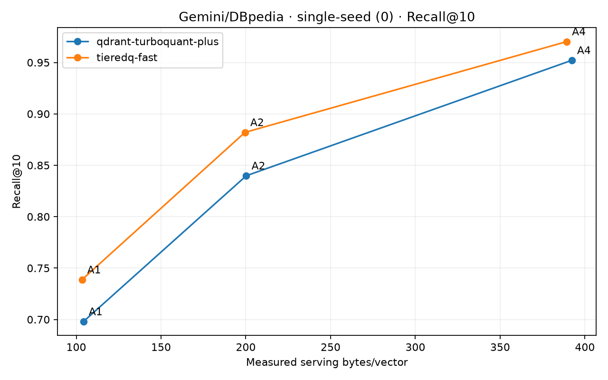
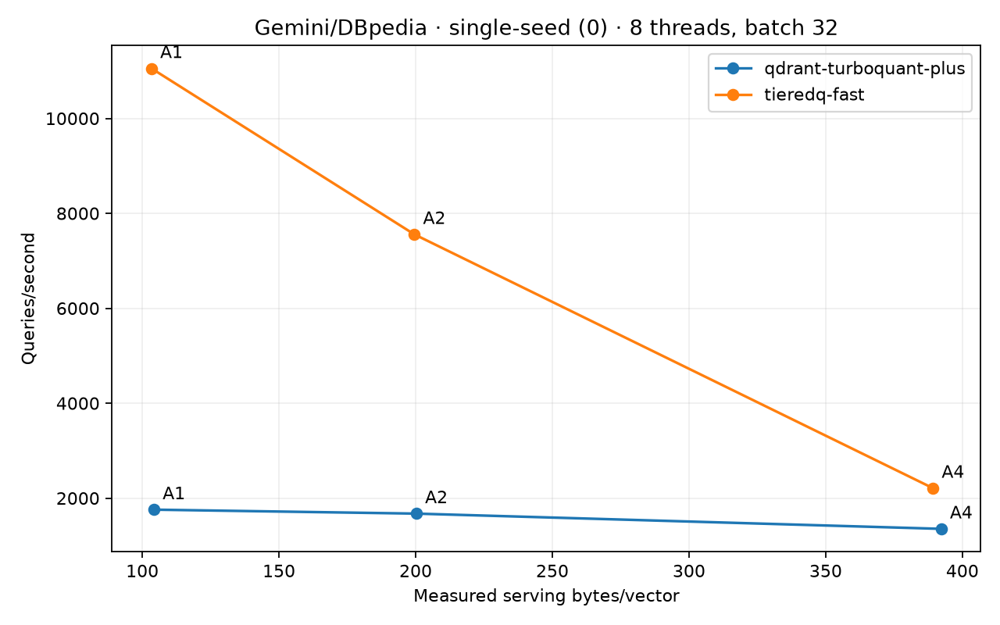
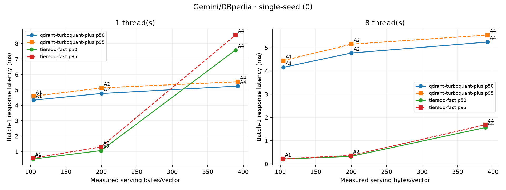

# Gemini/DBpedia: native Qdrant TurboQuant versus TieredQ fast

Single-seed experiment (seed 0), Hartmut i9-7980XE, CPUs 0–7. All 24 scheduling rows passed the audit. No statistical-confidence claims. Queries are held-out document vectors, not independently embedded search queries.

100,000 finite 768D Google `models/embedding-001` vectors; 99,000 corpus rows and 1,000 disjoint held-out queries. Both sides use identical FP32-normalized arrays and exhaustive FP32 cosine top-10 ground truth. Dataset revision: `e14a0f193988e9efb7ccc57b4c615418e6540f62`.

| Pair | Codec | Requested / learned code bits | Bytes/vector | Below anchor | Recall@10 | Build s | Encode vectors/s | QPS (8t/32) | 1t p50/p95 ms | 8t p50/p95 ms |
|---|---|---:|---:|---:|---:|---:|---:|---:|---:|---:|
| A1 | qdrant-turboquant-plus | 768 / 768 | 104.267 | 0.000% | 0.6980 | 1.711 | 63,203 | 1,757.2 | 4.334/4.588 | 4.152/4.444 |
| A1 | tieredq-fast | 470 / 470 | 103.370 | 0.860% | 0.7387 | 3.684 | 346,693 | 11,052.0 | 0.510/0.569 | 0.207/0.222 |
| A2 | qdrant-turboquant-plus | 1536 / 1536 | 200.267 | 0.000% | 0.8398 | 2.125 | 51,480 | 1,673.8 | 4.765/5.131 | 4.769/5.149 |
| A2 | tieredq-fast | 1044 / 1044 | 199.517 | 0.374% | 0.8820 | 3.828 | 201,303 | 7,556.4 | 1.062/1.299 | 0.323/0.359 |
| A4 | qdrant-turboquant-plus | 3072 / 3072 | 392.267 | 0.000% | 0.9521 | 2.805 | 40,879 | 1,352.9 | 5.243/5.525 | 5.241/5.542 |
| A4 | tieredq-fast | 2778 / 2778 | 389.245 | 0.770% | 0.9703 | 4.289 | 111,889 | 2,209.7 | 7.582/8.554 | 1.564/1.682 |

Calibration uses only measured storage: first feasible attempt within 0.5%, otherwise the largest measured feasible layout after bounded integer search. `calibration.json` retains every attempt; `selections.json` records choices. These are discrete within-memory comparisons. No interpolation or nominal-bit equality.

Calibration wall time: 97.62 s. Selected construction: 18.44 s. Matrix/search and result capture wall time: 208.52 s. TieredQ construction times training and add/pack, excluding save/reload I/O. Qdrant construction times production calibration/encoding plus adapter compaction/persistence. These construction timers have different adapter boundaries; search timings both cover preprocessing, full scan and top-k.

Storage is max(saved bytes, reloaded serving allocations including model and shell). `anchors.json` and `selections.json` separate disk, resident, code/cache/model and adapter allocations. No FP32 corpus storage, HNSW, filtering or original-vector reranking is retained by either index. Input arrays, transient score/top-k/query scratch, allocator bookkeeping and language/thread runtimes are outside this allocation measure; it is not process RSS.

See [integration details](INTEGRATION.md) for production API constraints, calibration, actual bit paths, query precision, build flags and serving state. `provenance/` contains pinned dependencies, source manifests/patches, compiler commands, host state, dataset checksums and split IDs; `binaries/` contains the measured shared libraries. Full sources, datasets, build trees and model artifacts remain in the isolated remote workspace recorded in `local-state.json`.

Three single-query warmups precede each scheduling point; all 1,000 queries run three timing repeats. Raw call times and predictions are retained. Batch-32 latency is whole-batch response latency, including the final partial batch. Scheduling recall is identical per codec/anchor: no recall values were averaged across schedules. Quantization recall differences between anchors are retained as measured.

