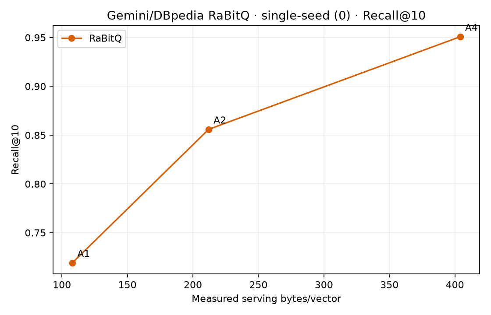
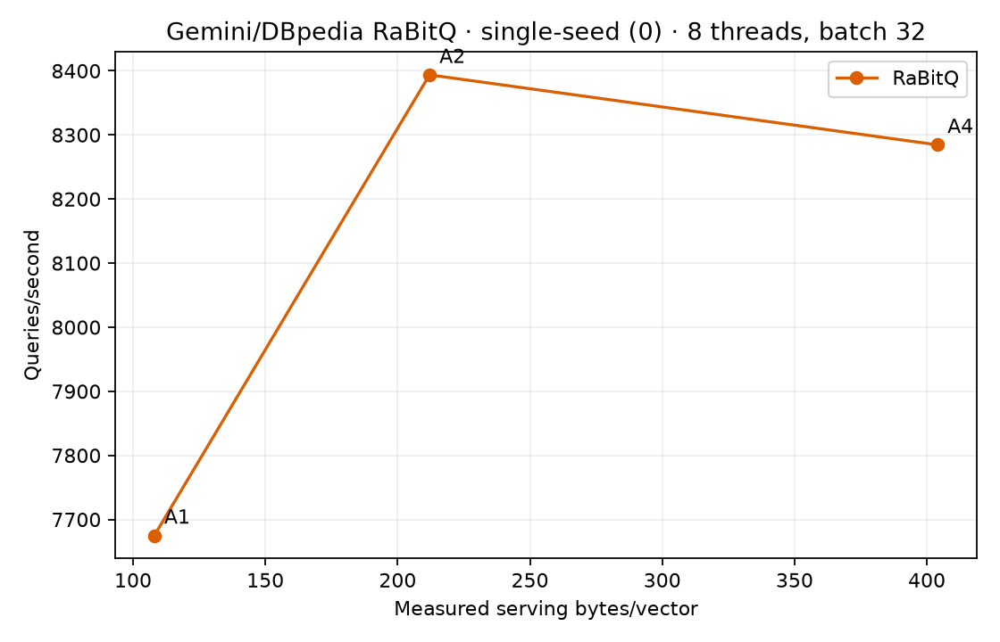
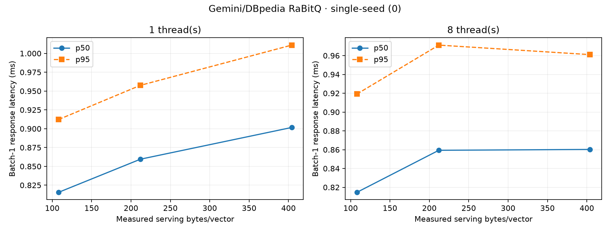

# Gemini/DBpedia: repository RaBitQ flat adapter

Single-seed experiment (seed 0), Hartmut i9-7980XE, CPUs 0–7. All 12 scheduling rows passed the audit. No statistical-confidence claims. Queries are held-out document vectors, not independently embedded search queries.

99,000 corpus rows and 1,000 disjoint held-out queries from the 100,000 × 768D Google Gemini/DBpedia dataset. Inputs are FP32-normalized and are the exact arrays used by the Qdrant TurboQuant/TieredQ bundle. Ground truth is exhaustive FP32 cosine top-10. Dataset revision: `e14a0f193988e9efb7ccc57b4c615418e6540f62`.

| Pair | Codec | Code bits | Bytes/vector | Recall@10 | Build s | Encode vectors/s | QPS (8t/32) | 1t p50/p95 ms | 8t p50/p95 ms |
|---|---|---:|---:|---:|---:|---:|---:|---:|---:|
| A1 | rabitq | 768 | 108.044 | 0.7192 | 0.076 | 2,405,830 | 7,675.0 | 0.816/0.912 | 0.815/0.919 |
| A2 | rabitq | 1536 | 212.044 | 0.8559 | 1.151 | 87,972 | 8,393.7 | 0.860/0.958 | 0.859/0.971 |
| A4 | rabitq | 3072 | 404.044 | 0.9508 | 2.042 | 49,132 | 8,284.5 | 0.902/1.011 | 0.860/0.961 |

RaBitQ uses the repository's official pinned RaBitQ-Library adapter: flat row-position storage, no IVF container, FHT/Kac rotation, native HACC split-batch kernels with extra-bit bound pruning, and the seeded rotation overlay. One-bit rows store no extra-bit payload; 2/4-bit rows store 1/3 extra bits per dimension. Build time covers rotation, global mean and native encode/pack; saving the flat representation is measured separately.

Anchor construction wall time: 4.19 s. Search matrix and artifact capture: 27.46 s. Storage is max(saved flat bytes, adapter serving bytes); the existing adapter does not expose a load path, so reload identity is not tested. Search timings include rotation, full scan, extra-bit scoring and top-k.

Three single-query warmups precede each scheduling point; all 1,000 queries run three timing repeats. Raw call times and predictions are retained. Batch-32 latency is whole-batch response latency, including the final partial batch. Scheduling recall is identical per anchor.

`provenance/` contains the pinned dataset manifest, split IDs, truth hash, RaBitQ patch hashes, compiler commands, source and binary hashes and host state. `binaries/` contains the measured extension.

