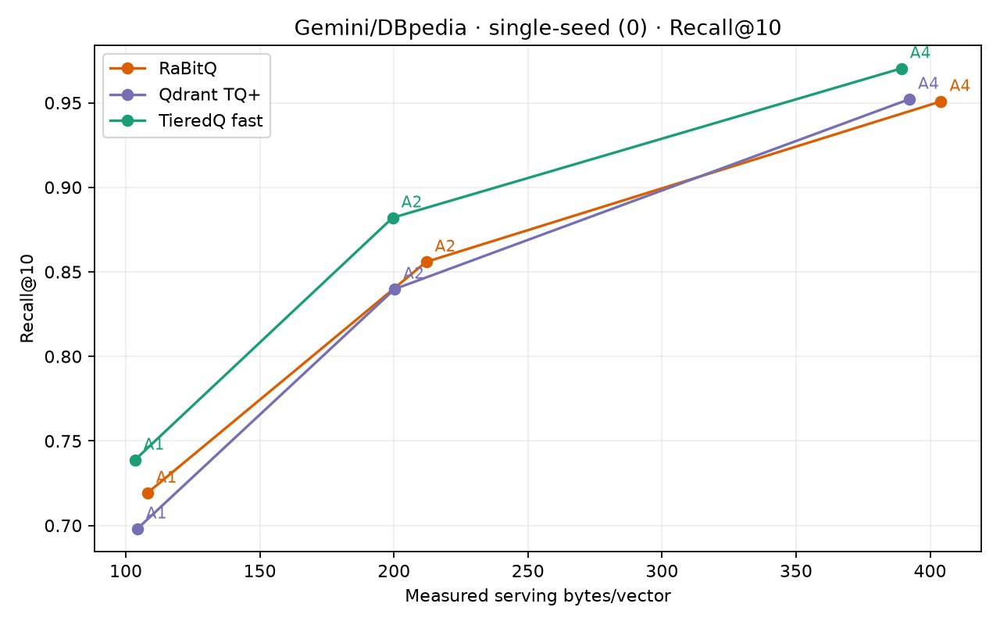
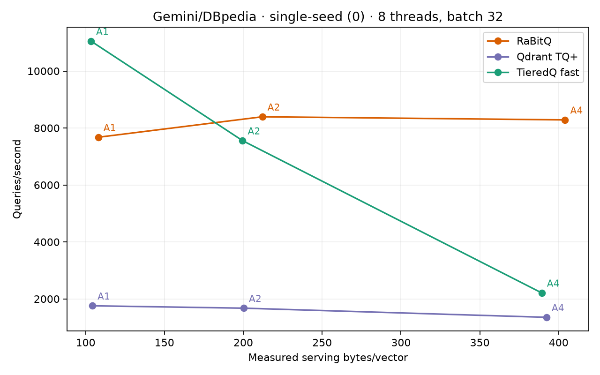
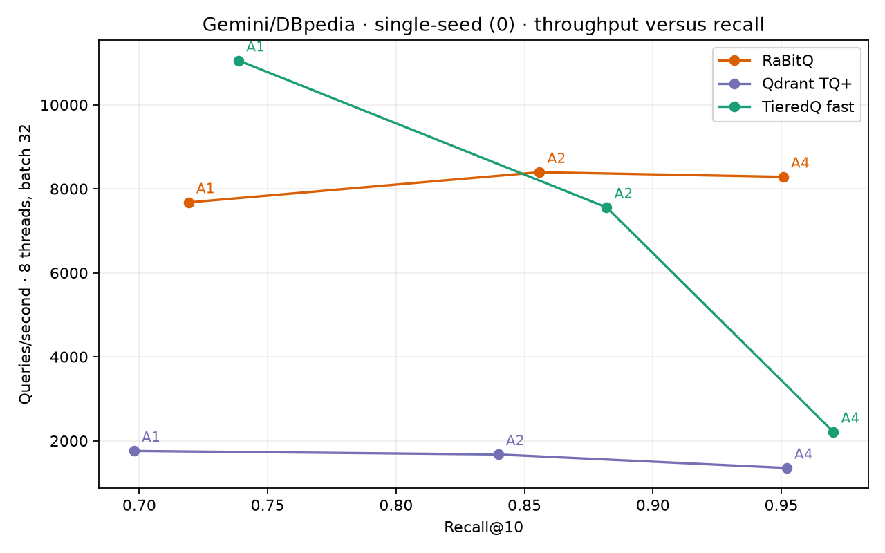
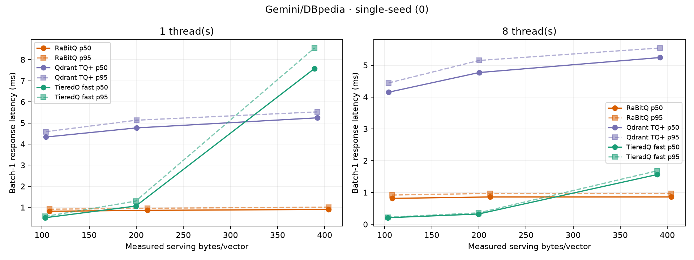

# Gemini/DBpedia: TieredQ fast vs Qdrant TurboQuant+ vs RaBitQ

Single-seed experiment (seed 0), Hartmut i9-7980XE, CPUs 0–7. All 36 scheduling rows passed the audit. No statistical-confidence claims. Queries are held-out document vectors, not independently embedded search queries.

99,000 corpus rows and 1,000 disjoint held-out queries from the same 100,000 × 768D Gemini/DBpedia dataset. All three codecs use identical FP32-normalized arrays and exhaustive FP32 cosine top-10 ground truth. Dataset revision: `e14a0f193988e9efb7ccc57b4c615418e6540f62`.

## Primary results (8 threads, batch 32)

| Pair | Codec | Requested code bits | Bytes/vector | vs Qdrant anchor | Recall@10 | QPS | 1t p50/p95 ms | 8t p50/p95 ms |
|---|---|---:|---:|---:|---:|---:|---:|---:|
| A1 | RaBitQ | 768 | 108.044 | +3.623% | 0.7192 | 7,675.0 | 0.816/0.912 | 0.815/0.919 |
| A1 | Qdrant TQ+ | 768 | 104.267 | +0.000% | 0.6980 | 1,757.2 | 4.334/4.588 | 4.152/4.444 |
| A1 | TieredQ fast | 470 | 103.370 | -0.860% | 0.7387 | 11,052.0 | 0.510/0.569 | 0.207/0.222 |
| A2 | RaBitQ | 1536 | 212.044 | +5.881% | 0.8559 | 8,393.7 | 0.860/0.958 | 0.859/0.971 |
| A2 | Qdrant TQ+ | 1536 | 200.267 | +0.000% | 0.8398 | 1,673.8 | 4.765/5.131 | 4.769/5.149 |
| A2 | TieredQ fast | 1044 | 199.517 | -0.374% | 0.8820 | 7,556.4 | 1.062/1.299 | 0.323/0.359 |
| A4 | RaBitQ | 3072 | 404.044 | +3.002% | 0.9508 | 8,284.5 | 0.902/1.011 | 0.860/0.961 |
| A4 | Qdrant TQ+ | 3072 | 392.267 | +0.000% | 0.9521 | 1,352.9 | 5.243/5.525 | 5.241/5.542 |
| A4 | TieredQ fast | 2778 | 389.245 | -0.770% | 0.9703 | 2,209.7 | 7.582/8.554 | 1.564/1.682 |

## Interpretation

- At the nominal 1/2/4-bit anchors, RaBitQ uses **3.0–5.9% more serving bytes** than the Qdrant anchor because its flat format stores native per-block factors and the rotation/center state. Its recall is above Qdrant TQ+ at 1 and 2 bits, and slightly below it at 4 bits (0.9508 versus 0.9521) while using 3.0% more storage. It is not a strictly equal-storage point.
- TieredQ is the only codec at or below each Qdrant anchor (0.86%, 0.37%, 0.77% below) and has the highest recall at every anchor. Its 4-bit row uses learned 5/6-bit tiers under the same total code budget.
- RaBitQ is much faster than Qdrant TQ+ at every anchor in batch 32. It is slower than TieredQ at 1 and 2 bits and faster at 4 bits, where TieredQ's learned high-bit path is more expensive.
- These are compressed-only exhaustive searches with native top-k. Neither an ANN container nor original-vector reranking is used.

## Measurement boundaries

Each codec's storage is the measured serving bytes: `max(saved bytes, reloaded serving allocation)` for TieredQ, `max(saved codes/model, resident quantizer allocation)` for Qdrant, and the flat saved/RaBitQ allocation for RaBitQ. Input FP32 arrays, transient query/top-k/score scratch and language runtimes are excluded; this is not process RSS.

RaBitQ and Qdrant timings include query preprocessing, full scan and top-k. TieredQ uses its native set-up and scan/selection scheduling. Build times are not compared here: the bundles have different construction boundaries (Qdrant includes calibration and persistence, TieredQ includes training and add/pack, RaBitQ includes rotation/mean and encode/pack).

The Qdrant/TieredQ rows were measured in the issue #15 run; the RaBitQ rows were measured in a subsequent run on the same host and CPU set. The runs were not interleaved, so QPS and latency are subject to run-to-run host variation. No confidence intervals are claimed.

Three single-query warmups precede each scheduling point; all 1,000 queries run three timing repeats and every repeat is checked against the serial reference. Raw timings and predictions for all codecs are retained in their source bundles. This combined directory contains the merged rows, independent audit and figures.

## Source artifacts

- Qdrant TQ+ / TieredQ: `../gemini-qdrant-turboquant-single-seed-20261026/`
- RaBitQ: `../gemini-rabitq-single-seed-20261026/`

Both bundles carry the same pinned dataset manifest and identical base/query/truth hashes. The RaBitQ bundle records a separate run and binary but uses the same prepared arrays.

