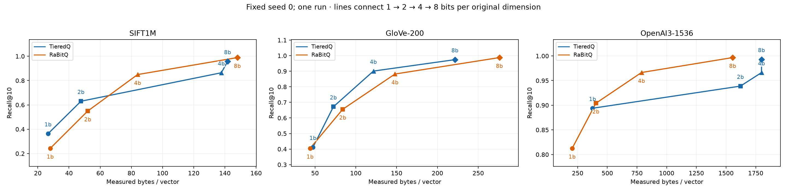
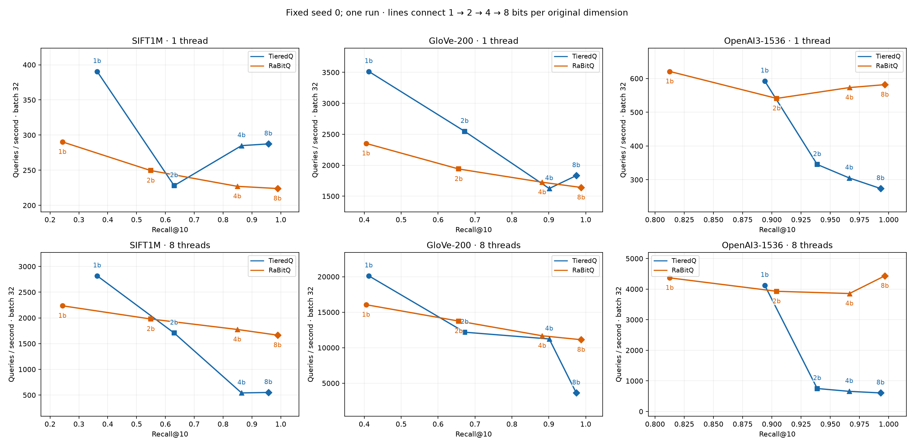
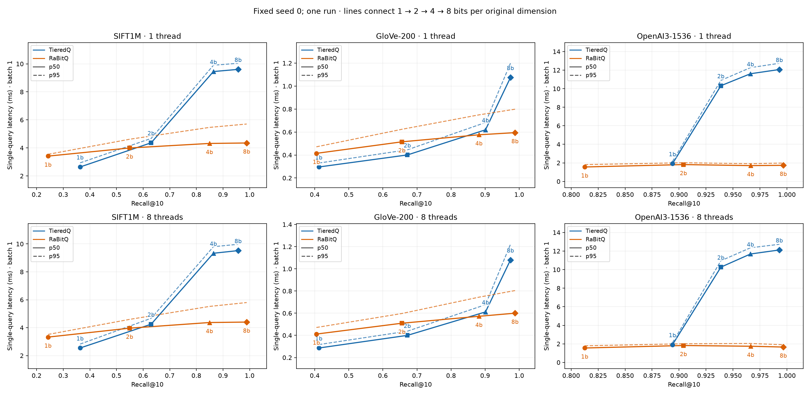

# Hartmut full matrix: fixed seed 0, 2026-10-23

All 24 codec configurations and 96 CSV rows completed: SIFT1M, GloVe-200 and OpenAI3-1536; TieredQ fast-native and RaBitQ direct-flat; budgets 1/2/4/8 bits per original dimension; threads 1/8; query batches 1/32. Each point uses 1,000 queries, three warmup queries and three timing repeats. This is one independent run, with no seed sweep or statistical-confidence claim.

Core matrix time: **881.97 seconds (14m42s)**, below the one-hour acceptance bound. Separate diagnostics: 171.07 seconds. Dataset preparation, truth and native compilation are excluded from core matrix time.

## Results

QPS below is 8-thread batch-32 throughput. Storage is measured total effective bytes per vector, including required model state and padding; budgets are not equal-memory comparisons. Build seconds include native index construction/training and encoding.

| Dataset | Codec | Budget | Recall@10 | Bytes/vector | QPS | Build seconds |
|---|---|---:|---:|---:|---:|---:|
| sift | tieredq | 1 | 0.3633 | 26.580 | 2,818 | 0.897 |
| sift | tieredq | 2 | 0.6302 | 47.704 | 1,707 | 1.226 |
| sift | tieredq | 4 | 0.8641 | 137.698 | 542 | 2.102 |
| sift | tieredq | 8 | 0.9570 | 141.723 | 551 | 7.803 |
| sift | rabitq | 1 | 0.2429 | 28.001 | 2,235 | 0.134 |
| sift | rabitq | 2 | 0.5493 | 52.001 | 1,979 | 1.578 |
| sift | rabitq | 4 | 0.8493 | 84.001 | 1,775 | 2.724 |
| sift | rabitq | 8 | 0.9890 | 148.001 | 1,665 | 11.167 |
| glove | tieredq | 1 | 0.4121 | 47.501 | 20,122 | 0.530 |
| glove | tieredq | 2 | 0.6719 | 72.534 | 12,185 | 0.533 |
| glove | tieredq | 4 | 0.9011 | 121.580 | 11,233 | 0.746 |
| glove | tieredq | 8 | 0.9744 | 221.476 | 3,633 | 1.569 |
| glove | rabitq | 1 | 0.4049 | 44.012 | 16,056 | 0.028 |
| glove | rabitq | 2 | 0.6559 | 84.012 | 13,750 | 0.357 |
| glove | rabitq | 4 | 0.8821 | 148.012 | 11,679 | 0.610 |
| glove | rabitq | 8 | 0.9878 | 276.012 | 11,125 | 2.422 |
| openai | tieredq | 1 | 0.8939 | 375.762 | 4,126 | 14.182 |
| openai | tieredq | 2 | 0.9388 | 1621.288 | 751 | 15.178 |
| openai | tieredq | 4 | 0.9662 | 1798.682 | 658 | 16.276 |
| openai | tieredq | 8 | 0.9930 | 1798.804 | 606 | 26.367 |
| openai | rabitq | 1 | 0.8126 | 204.070 | 4,368 | 0.113 |
| openai | rabitq | 2 | 0.9041 | 404.070 | 3,929 | 2.592 |
| openai | rabitq | 4 | 0.9664 | 788.070 | 3,857 | 4.312 |
| openai | rabitq | 8 | 0.9967 | 1556.070 | 4,435 | 14.550 |

## Measured tradeoffs

- SIFT: TieredQ at 1 bit has higher recall, lower storage and higher batch throughput than the measured RaBitQ 1-bit point. At 8 bits, RaBitQ has higher recall and about 3.02× throughput, with 4.4% more storage; TieredQ builds faster. The SIFT TieredQ L2-to-IP query transform and extra-coordinate storage are included.
- GloVe: TieredQ has higher recall at budgets 1/2/4. At 8 bits RaBitQ has higher recall and about 3.06× throughput, using 24.6% more storage; TieredQ builds faster.
- OpenAI: RaBitQ at 2 bits offers higher recall than TieredQ at 1 bit (0.9041 vs 0.8939), using slightly more storage (404.070 vs 375.762 bytes); this pair does not establish equal-memory dominance. At 4 bits, RaBitQ uses 788.070 bytes vs TieredQ 1798.682, with nearly identical recall (0.9664 vs 0.9662) and 5.86× throughput. At 8 bits RaBitQ has higher recall, lower storage, about 7.32× throughput and lower build time.

Minimum measured storage reaching Recall@10 ≥ 0.95:

| Dataset | TieredQ bytes/vector (budget) | RaBitQ bytes/vector (budget) |
|---|---:|---:|
| sift | 141.723 (8) | 148.001 (8) |
| glove | 221.476 (8) | 276.012 (8) |
| openai | 1798.682 (4) | 788.070 (4) |

These are discrete measured points reaching a recall floor, not exact equal-recall points or interpolated optima. Exact equal-memory/recall matches are absent from this grid. See `summary.json` for within-budget comparisons. The high-budget gap and storage discontinuities are tracked in [issue #12](https://github.com/SeanPedersen/TieredQ/issues/12).

## Verification and provenance

- `./validate.sh` passed all 13 tests before the run, including official reference parity at 128/200/1536 dimensions, all budgets, both metrics and a partial block.
- `completeness-audit.json` verifies 96 unique result rows and 96 diagnostic rows, finite timings, identical recall/storage across scheduling rows, seed 0, dimensions/base counts, CPU affinity 0–7, unchanged as-run source hashes and all five audited codec compiler commands.
- Effective flags are `-O3 -march=native -ffp-contract=off`; nanobind `NOMINSIZE` prevents an `-Os` override. RaBitQ retains native pruning/HACC and has implicit row IDs with no IVF container. TieredQ storage conservatively includes derived encoder state; these measures are not process RSS.
- `data-manifest.json` records pinned sources and full base/query hashes, independently rechecked after the run. SIFT/GloVe raw SHA256 checksums were rechecked. Split index arrays are preserved.
- All three plots were rendered and visually inspected. Revised presentation labels all four budgets in allocation order, uses consistent codec colors and separate scheduling panels. Curves connect measured points, without claiming interpolated performance. Single-query latency is response latency; batch latency is not divided by batch size.
- 24 of 96 diagnostic points have native preprocessing above 10%; see `preprocessing.csv`. Native-only diagnostics exclude the Python SIFT query lift and are not cross-codec parallel-latency comparisons.
- Original native sources, harness, dependency lock and dataset catalogue are in `as-run-sources.tar.gz`, identified by `validated-source-sha256.json`; original compiler/source metadata remains unchanged. Plot presentation was updated after timing; current `plotting.py` and `report.py` reproduce the delivered figures from the unchanged CSV. Generic summary `recall_std=0` fields reflect a single seed and provide no uncertainty estimate.
- The detached wrapper EXIT trap failed to write its relative-path exit marker after a directory change. Final metadata records both completed phases; `completion.json` and the independent artifact audits document verified completion. No nonzero benchmark failure appears in the run log.

## Artifacts and reproduction

Artifacts are in [`output-full-single-run/`](output-full-single-run/). Original remote directory: `sean@hartmut:/home/sean/experiments/TieredQ-issue4-20261023/TieredQ/benchmark/output-full-single-run`.

```sh
cd benchmark
./validate.sh
taskset -c 0-7 ./run.sh --seeds 0 --output output-new-single-run
```

Use a new output directory. The remote snapshot had user modifications, preserved in the archive and tracked diff; do not reproduce from remote HEAD alone. Earlier IVF/-Os outputs are invalid and were not used.






