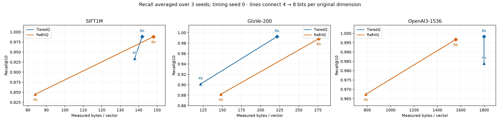
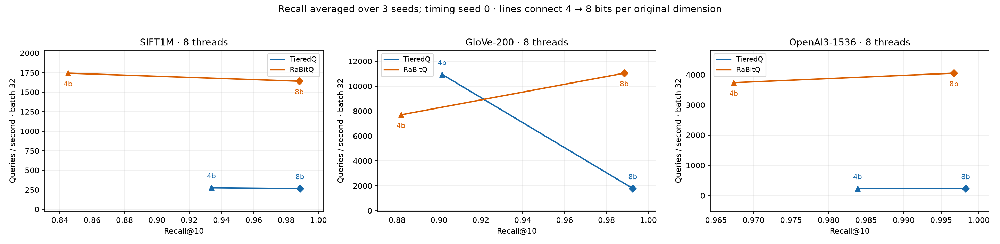

# Issue #12: high-bit recall

The recall fix is implemented and verified. A [scan optimization follow-up](scan-opt/README.md) later raised throughput 3.7–7.8× at points containing 7/8-bit tiers, with identical recall and storage. A [packed storage follow-up](pack-opt/README.md) then halved 4-bit storage (SIFT 137.8 → 73.3, OpenAI 1,799 → 888 B/vector) with identical recall. QPS below is the recall-fix delivery. Fast mode preserves the codec’s high-bit codebook precision, and the SIFT benchmark uses a query-sensitive, metric-preserving L2 transform. [Source-level investigation](../../../docs/high-bit-recall.md).

The approved [threshold-5 follow-up](code5/README.md) records the final routing
policy. All archived serving-memory figures predate the [final-review accounting
correction](../../../docs/high-bit-recall.md#final-review-accounting-correction)
and omit some fast-cache allocations; their raw measurements are preserved.
The [corrected current serving-memory table](storage-refresh/README.md) refreshes
all eleven reported configurations across seeds 0/1/2. GloVe 4-bit is now
118.706 bytes/vector, so it no longer fits within RaBitQ’s historical 3-bit budget.

The result directory is historical evidence. Experimental kernels, patches and
machine-specific shell drivers document past runs and are not supported setup
entry points. The source archives intentionally preserve their original bytes
and hashes; the packed-storage archive also contains incidental Python bytecode.

## Primary results

Full original datasets, 1,000 held-out queries, top-10, nominal 8-bit budgets. Recall is averaged over seeds 0/1/2; ranges show those three observations. QPS and construction time use seed 0, **8 threads, batch 32**, three warmups and three timing repeats. Storage is the maximum measured across seeds, including SIFT adapter state. These are not exact equal-memory comparisons.

| Dataset | Codec | Recall@10 mean (range) | Bytes/vector | QPS | Build seconds |
| --- | --- | ---: | ---: | ---: | ---: |
| SIFT1M | TieredQ | 0.98853 (0.9866–0.9896) | 141.859 | 266 | 8.518 |
| SIFT1M | RaBitQ native | 0.98820 (0.9874–0.9890) | 148.001 | 1,641 | 10.899 |
| GloVe-200 | TieredQ | 0.99257 (0.9921–0.9928) | 221.486 | 1,779 | 1.589 |
| GloVe-200 | RaBitQ native | 0.98850 (0.9878–0.9897) | 276.012 | 11,043 | 2.329 |
| OpenAI3-1536 | TieredQ | 0.99827 (0.9981–0.9986) | 1798.814 | 233 | 26.380 |
| OpenAI3-1536 | RaBitQ native | 0.99670 (0.9962–0.9972) | 1556.070 | 4,052 | 13.708 |

SIFT’s ranges overlap; three seeds do not establish statistical superiority. GloVe and OpenAI show clearer recall gains. Normal-mode seed-0 recall exactly matches fast mode on all three full datasets: SIFT 0.9894, GloVe 0.9921 and OpenAI 0.9981. Normal mode already retained FP32 codebook scoring; the SIFT adapter correction applies to both modes.

The precision-preserving fast scan is slower than the original int8 approximation. Independent repeat QPS at the 8-bit points is 276/1,620/238 for SIFT/GloVe/OpenAI, versus primary values 266/1,779/233. This is approximately a 2–2.6× throughput loss versus the original fast path, with substantial recall recovery. Native RaBitQ remains faster.

The complete primary CSV also contains 4-bit-budget points: mean TieredQ/RaBitQ recall is 0.93383/0.84503 (SIFT), 0.90153/0.88183 (GloVe), and 0.98387/0.96737 (OpenAI). Discrete measured-storage/recall comparisons are in `summary.json`; absent matches remain null.





## Evidence

- `results.csv`, `meta.json`, `summary.json`: 36 primary rows, budgets 4/8, seeds 0/1/2, native RaBitQ pruning/HACC enabled. Core matrix: 385.68 seconds. Nonzero seeds evaluate recall only and intentionally have NaN timing fields. The selected final run measures batch 32; batch response latency is not single-query latency.
- `as-run-sources.tar.gz`, `data-manifest.json`: exact primary compiler inputs/harness, pinned upstream revision/patches in metadata, and original base/query hashes. The isolated source copy has no Git checkout; metadata records null revisions rather than a misleading commit identifier.
- `recall-baseline.json`: controlled original fast versus FP32 comparison at seed 0. The original corrected #4 matrix remains in the sibling result bundle.
- `normal-reference-final.json`: full-data normal-mode reference. Its diagnostic storage excludes the Python adapter and is not the primary storage measure.
- `repeat/`: independent seed-0 TieredQ 8-bit timing repetition on the delivered scan implementation after layout constants were centralized. Recall is unchanged. Primary and repetition source snapshots identify each measured version.
- `layouts.json`: all 12 original allocations and independently reconstructed legacy storage components. Every original TieredQ byte/vector value matches to numerical precision; the trace explains both SIFT and OpenAI discontinuities.
- `preprocessing.csv`: separately instrumented projection/weights, centroid, LUT, fused scan/accumulation and selection/finalization. Phase columns contain worker milliseconds per query, including profiling warmups, not additive parallel wall time. The original auxiliary profiling command encountered a copied CMake-cache path mismatch after core measurements completed; moving the stale copied cache and running a fresh stage build recovered the diagnostic without changing primary results.
- `full-score/`: separately labeled **RaBitQ-only** seed-0 diagnostic disabling extra-bit bound pruning. Its QPS is 289/1,447/281; recall is 0.9890/0.9915/0.9972. Primary comparisons retain native bounds. Reproduction helper: `run-full-score.sh`.
- `experiments/`: intermediate code-ID kernels, norm-coordinate scaling and query-metric diagnostics. Their exploratory timings are not primary serving comparisons; adapter diagnostics omit its extra storage/preprocessing costs. The discarded encoder-refinement patch is retained. `numeric-variant/` is an explicitly interrupted exploratory calibration variant, not a completed comparison.
- `calibration-guard-check.json`: the delivered rank-deficient-sample fallback preserves both full SIFT transform maps byte-for-byte.
- `audit.py`, `audit.json`: matrix uniqueness, shapes, source/harness snapshot hashes, normal/fast recall equality, repeated recall, original storage reconstruction and diagnostic separation.

## Validation

C++ suites pass on ARM and x86, including scalar score/top-k parity at high precision, partial blocks and query tiles. The Python API suite passes 42 tests; Linux benchmark validation passes 16 tests, including official RaBitQ native-reference parity. New fast payloads preserve code IDs and validate active and padded codes. Legacy numerical-level files retain their original approximation; rebuild to recover lost precision.

## Reproduction

From a Linux checkout with the pinned datasets cached; choose new output names:

```sh
cd benchmark
./validate.sh
taskset -c 0-7 ./run.sh --bits 4 8 --threads 8 --batches 32 --seeds 0 1 2 --output output-new
taskset -c 0-7 uv run --locked --python 3.12 python profile.py output-new --stages
taskset -c 0-7 uv run --locked --python 3.12 python trace_layouts.py --output layouts-new.json
taskset -c 0-7 uv run --locked --python 3.12 python investigate_recall.py --query-metric --bits 8 --modes fp32 --recall-only --output normal-new.json
```

`--legacy-l2-lift` retains the original SIFT adapter. Omitting `--threads`/`--batches` measures the full 1/8-thread and 1/32-batch scheduling grid; single-query high-precision scans make that substantially slower. Profiling uses a separate generated source/build tree. Current remote workspace: `sean@hartmut:/home/sean/experiments/TieredQ-issue12-recall`. The original issue #4 workspace and outputs were preserved.
