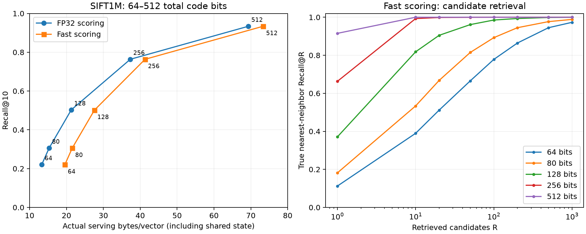

# Issue #14: TieredQ at tiny total-code budgets

**This is a TieredQ-only experiment at budgets discussed by Brandt, not a faithful Brandt implementation or a head-to-head comparison.** No measured Brandt baseline is included. The tested codec retains TieredQ's cluster residuals, default tier rotations, pinned Gaussian codebooks, row RMS/scale-grid processing, radial factor, and centroid correction. SIFT uses the corrected query-metric L2 adapter.

The compact models have limited top-10 accuracy but good candidate-retrieval recall. At 128 total residual-code bits, fast serving achieves mean Recall@10 of 50.14%, while retaining the true nearest neighbor in the top 100 candidates 98.53% of the time. That suggests a candidate-generation use case; end-to-end reranking was not implemented or timed.

## Quality and actual serving storage

Full SIFT1M base, 1,000 held-out queries, three training seeds. Values are means across seeds. Recall@10 is the fraction of the true top ten retrieved in the first ten; NN@100 is the probability that the exact first nearest-neighbor ID is in the first 100 candidates. These are different metrics.

| Total code bits | Scorer | Retained dimensions | Recall@10 | NN@100 | NN@1000 | Actual serving B/vector | Row stride B |
| ---: | --- | ---: | ---: | ---: | ---: | ---: | ---: |
| 64 | FP32 | 33 | 22.05% | 77.53% | 97.40% | 13.288 | 13 |
| 64 | fast | 33 | 22.02% | 77.83% | 97.33% | 19.559 | 19 |
| 80 | FP32 | 39 | 30.58% | 89.23% | 98.97% | 15.291 | 15 |
| 80 | fast | 39 | 30.57% | 89.27% | 98.87% | 21.563 | 21 |
| 128 | FP32 | 55 | 50.29% | 98.57% | 100.00% | 21.300 | 21 |
| 128 | fast | 55 | 50.14% | 98.53% | 100.00% | 27.574 | 27 |
| 256 | FP32 | 90 | 76.37% | 100.00% | 100.00% | 37.319 | 37 |
| 256 | fast | 90 | 76.37% | 100.00% | 100.00% | 41.320 | 41 |
| 512 | FP32 | 126 | 93.39% | 100.00% | 100.00% | 69.340 | 69 |
| 512 | fast | 126 | 93.39% | 100.00% | 100.00% | 73.343 | 73 |



At the three small budgets, FP32 versus fast recall is nearly the same: serving approximation is not the main accuracy loss. Increasing the residual-code budget has a much larger effect.

Actual memory differs substantially from nominal code bytes. A 64-bit residual code is eight bytes, but the FP32 representation uses a 13-byte row stride and fast serving uses a 19-byte stride, plus shared state. FP32 rows add five metadata bytes. Fast rows use two FP32 values and one centroid byte (nine bytes), and narrow lookup packing adds two bytes beyond the eight nominal code bytes at this point. Padding and shared cache/model/adapter state account for the remaining difference in the measured total. These budgets therefore cannot be compared with Brandt's nominal code size as if they were equal-memory representations.

An approximately equal-memory illustration: the 128-bit FP32 point uses 21.300 B/vector and gets 50.29% Recall@10, while the 80-bit fast point uses 21.563 B/vector and gets 30.57%. Speed and actual memory must be considered together; nominal bits alone do not define the operating point.

## End-to-end serving timings

Seed 0 only, no profiling instrumentation, pinned to CPUs 0–7 on an Intel Core i9-7980XE. Include query lift/map multiplication, query preparation, exhaustive scan, and top-k selection. Request eight threads; use the first 128 queries for single-query latency and all 1,000 for batch-32 throughput. Three warmups per case, three repeats, and seeded shuffled order across budget/scorer/thread/batch cases. Values below aggregate the three repeats.

| Total bits | Fast single-query p50 | Fast single-query p95 | Fast batch-32 QPS | Fast batch response p50 |
| ---: | ---: | ---: | ---: | ---: |
| 64 | 0.331 ms | 0.498 ms | 3577 | 8.927 ms |
| 80 | 0.361 ms | 0.395 ms | 3191 | 9.708 ms |
| 128 | 0.439 ms | 0.827 ms | 2582 | 11.393 ms |
| 256 | 1.901 ms | 2.010 ms | 2226 | 13.483 ms |
| 512 | 3.113 ms | 7.309 ms | 1682 | 18.469 ms |

The raw and summarized timings also include FP32 scoring and one-thread single-query measurements. The FP32 single-query implementation does not split documents across workers in this snapshot, so requesting eight threads does not make that path an eight-worker scan. Fast single-query searches do split documents. The batch response latency column is the latency of a batch call, not amortized per-query latency; the last batch has eight queries.

The 64/80/128-bit models use the narrow byte-LUT serving representation. The 256/512-bit models include tiers wider than four bits and use packed code IDs with original FP32 reconstruction levels. Single-query fast latency rises sharply across this representation change, while batched decoding amortizes more of the work. This identifies a serving-layout transition worth investigating; it does not establish that a different allocator would improve recall at equal memory/latency.

Timing began after the other visible benchmark process finished. Background services remained, and this was not an exclusive-host run; p95 and per-repeat variability are retained. The earlier quality checks and phase diagnostics ran on CPUs 8–15 while other work could run on a disjoint CPU set. Timing results are hardware/workload-specific, not a replication of Brandt's throughput benchmark.

## Phase diagnostics

A separately instrumented source copy records preparation, scan, selection, and final merge. One thread, seed 0, one diagnostic call after a warmup at batches 1 and 32. The query adapter runs before the native phase timing. At batch 1, scan time accounts for approximately:

| Total bits | Fast scan / diagnostic wall time |
| ---: | ---: |
| 64 | 93.4% |
| 80 | 93.8% |
| 128 | 94.5% |
| 256 | 98.7% |
| 512 | 99.2% |

This points to scanning as the main serving cost rather than preparation or selection. Clocks and atomic counters perturb execution; these single-call ratios are diagnostic, not uninstrumented latency estimates. Preparation is wall time; scan/selection/merge counters sum worker elapsed time. They are comparable to wall duration here because the diagnostics use one thread. Uncaptured orchestration and instrumentation overhead remain.

## Protocol and integrity

- Full existing ANN benchmark SIFT base: 1,000,000 × 128 FP32 input values, 1,000 separate held-out queries, cached exact L2 top-10. The cache SHA-256 and dataset manifest are retained. This is not established to be the same INRIA Holidays evaluation corpus/split used in Brandt's paper.
- Corrected query-metric L2 adapter adds a dimension, so indexing operates on 129 dimensions. Total code budgets remain 64/80/128/256/512, equivalent to 0.5/0.625/1/2/4 bits per original dimension. Centroid/scaling/correction metadata is extra.
- Each seed samples 32,768 base vectors without replacement; 256 centroids, default rotations and Gaussian codebooks. Queries and ground truth are used only for evaluation; adapter calibration uses base vectors.
- Fifteen trained models, thirty FP32/fast quality evaluations. Top-1,000 retrieval gives the NN Recall@R curves, and separate top-10 calls on 32 queries verify identical prefix IDs and scores for every model/scorer.
- Ninety uninstrumented timing rows (30 settings × three repeats) and twenty phase rows. Actual timed Recall@10 is retained independently; single-query timing uses 128 queries, and adapter matmul can round differently with different batch shapes.
- Save/load canonicalizes serving allocations. Main storage counts `index.storage_bytes` + codec resident memory + existing adapter storage accounting after reload. It includes model/cache state, metadata and padding. Post-build counters, fixed stride and serialized file sizes are also retained. Caller-owned originals, transient query/top-k scratch, allocator bookkeeping and RSS are excluded. The difference from stride × row count includes padding as well as shared state.
- The Gaussian codebook arrays match across all trained recipes; exact budgets and matrix completeness were checked. Every codec passed serialization roundtrip checks. A preflight synthetic check verified the shared binding's legacy training entry point produces the same recipe as exact-total-bit training, and FP32/fast save-load preserves scores and IDs.
- Primary and diagnostic compilation flags were audited for effective `-O3`, `-march=native`, and `-ffp-contract=off`; nanobind uses `NOMINSIZE`. Frozen codec source hashes match between the beginning and end of measurements. Only the separate diagnostic source copy changes two scan/orchestration files for counters.
- Production code and public formats were not changed by this investigation. The source snapshot includes the working-tree codec at capture time, including the compact narrow query projection change from the parallel serving-memory work; the archived source hashes are authoritative.

## What this says about Brandt

This confirms that TieredQ can operate in Brandt's low-total-bit regime and reports its own accuracy/memory/speed tradeoffs. It does not measure the paper's transform coder or verify its performance claims. In particular, Brandt's 80-bit panorama inlier-ratio result is not the same task as top-10 retrieval recall.

The next direct comparison should implement Brandt's PCA, `log2(sigma)` allocation, trained per-coordinate scalar quantizers with the paper's distortion objective, and asymmetric L2 scoring on this same data. Start with accuracy and actual storage; compare both equal code budgets and equal total memory, then benchmark an optimized implementation. That baseline is more informative than treating the paper's plotted results as a measured comparator for TieredQ.

For a subsequent TieredQ scan experiment, investigation 3 (byte-sized versus register-sized lookup groups) is supported by the scan-heavy phase measurements. Keep numerical precision controlled and measure table construction, scan, selection, padding and actual bytes. Investigation 2 (serving-aware allocation) can then use measured layout costs rather than assumptions. No new kernel or allocator was implemented here.

## Reproduction and artifacts

[Experiment instructions](../../experiments/tiny_budgets/README.md) describe build, quality, timing and separate profiling commands. Stack: C++20/CMake/LAPACK/BLAS/OpenMP and the existing Python 3.12 uv environment with nanobind, NumPy, threadpoolctl and matplotlib.

Isolated remote workspace: `sean@hartmut:/home/sean/experiments/TieredQ-tiny-budgets-20261026-9NAZyQ`. Primary module: `build/tiny_native*.so`; diagnostic module: `build-profile/tiny_native*.so`. Seed-0 full indexes remain there for timing. This local bundle includes the raw model recipes and per-query compressed quality artifacts; full indexes and raw datasets are not copied.

From the remote workspace, quality used:

```sh
OPENBLAS_NUM_THREADS=1 OMP_NUM_THREADS=8 taskset -c 8-15 \
  /home/sean/experiments/TieredQ-issue4-current-20261026-tpj3ze/benchmark/.venv/bin/python \
  benchmark/experiments/tiny_budgets/quality.py \
  --data /home/sean/experiments/TieredQ-issue4-current-20261026-tpj3ze/benchmark/data \
  --native build --output results
```

Timing used `timing.py --native build --results results` on CPUs 0–7 with the same data/environment. Profiling used `timing.py --native build-profile --results results --profile` on CPUs 8–15. The primary and diagnostic builds used separate CMake build directories. All three runs completed with exit code 0.

- [Quality rows](quality.jsonl), [timing rows](timing.jsonl), [phase rows](phases.jsonl), and [aggregate summary](summary.json).
- [Quality manifest](manifest.json), [timing manifest](timing-manifest.json), [profile manifest](profile-manifest.json), and [dataset manifest](dataset.json).
- [Validation](validation.json), [compiler audits](compiler-audit.json), [provenance and binary hashes](provenance.json), and [CPU metadata](cpu.json).
- [Source snapshot](source-snapshot.tar.gz) and [diagnostic instrumentation patch](profiling.patch). Re-run `instrument.py` in a fresh source copy to regenerate portable local header paths; the preserved patch contains the original workspace paths.
- Model files `b*-s*.bin` are raw codec recipes for `TieredQ::deserialize`; they are not checksummed `.tq` containers. Per-query `b*-quality.npz` files store top-10 IDs, NN rank capped at 1001 (not found among the first 1000), and Recall@10 per query.

Python compilation and whitespace checks passed. The chart was rendered and visually inspected. No commit or production adoption is part of this experiment.

Source archive SHA-256: `fb88542818adc894a756e4ebef95d297175f8708aee17cc10820e5d21adf8cb1`.
