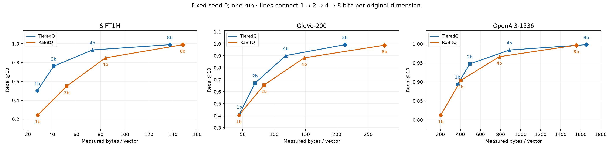
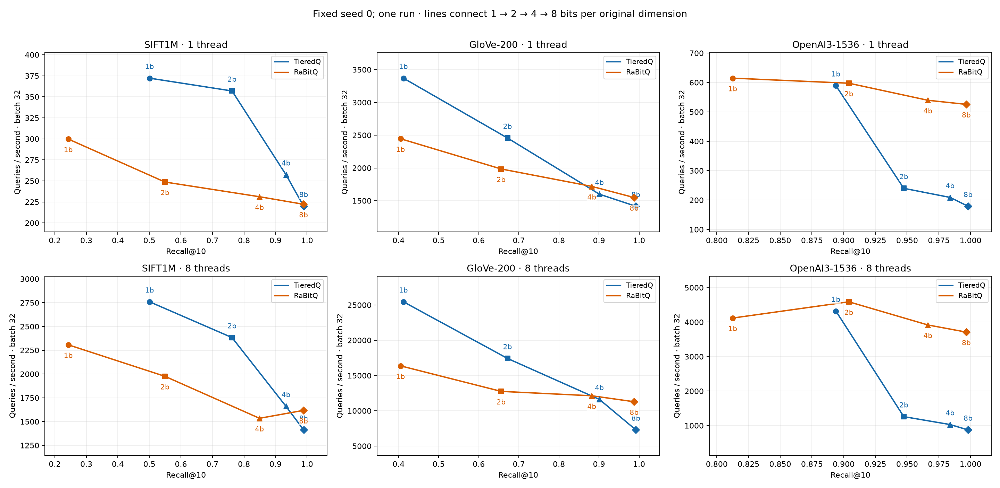
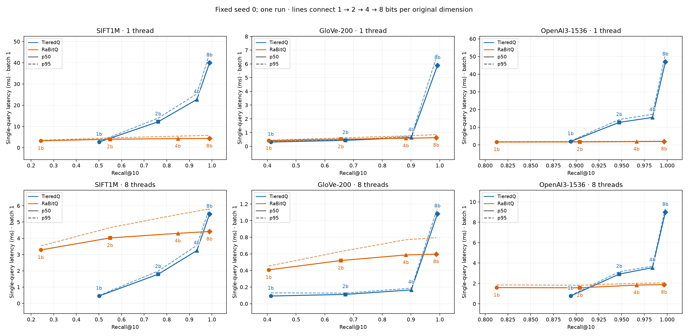

# Issue #4 refresh: current fast mode, seed 0

Full SIFT1M (1M × 128), GloVe (100K × 200) and OpenAI3 (100K × 1536), 1,000 held-out queries each; budgets 1/2/4/8, threads 1/8, batches 1/32. TieredQ fast mode only versus pinned native direct-flat RaBitQ with bounds and HACC enabled. Three warmup queries and three complete timing repeats. This is one single-seed run; it establishes no statistical confidence.

Core matrix wall time: **1076.91 seconds (17.95 minutes)**. Includes index construction and the whole scheduling matrix; excludes compilation, dataset verification/preparation and figure generation. No profiling or optimization runs were added. The sole follow-up diagnostic investigates the observed SIFT batch-dependent recall.

## Current measurements

QPS is the primary 8-thread/batch-32 point. Construction includes training, encoding/packing and SIFT adapter fitting/transformation. Encode throughput measures native add/encode/pack only, excluding training and adapter fit. Bytes/vector are freshly measured serving representations, including shared model/cache state and the SIFT adapter; these are not process RSS.

| Dataset | Codec | Bits | Recall@10 | Bytes/vector | QPS | Build s | Encode vectors/s |
|---|---|---:|---:|---:|---:|---:|---:|
| sift | tieredq | 1 | 0.5006 | 27.607 | 2,759 | 1.700 | 1,508,105 |
| sift | tieredq | 2 | 0.7622 | 41.320 | 2,383 | 1.961 | 1,086,300 |
| sift | tieredq | 4 | 0.9333 | 73.343 | 1,660 | 3.045 | 496,143 |
| sift | tieredq | 8 | 0.9894 | 137.347 | 1,412 | 8.334 | 137,611 |
| sift | rabitq | 1 | 0.2429 | 28.001 | 2,307 | 0.131 | 11,178,654 |
| sift | rabitq | 2 | 0.5493 | 52.001 | 1,976 | 1.525 | 674,236 |
| sift | rabitq | 4 | 0.8493 | 84.001 | 1,535 | 2.717 | 374,439 |
| sift | rabitq | 8 | 0.9890 | 148.001 | 1,618 | 11.076 | 90,713 |
| glove | tieredq | 1 | 0.4121 | 44.542 | 25,453 | 0.543 | 869,487 |
| glove | tieredq | 2 | 0.6719 | 69.603 | 17,418 | 0.619 | 639,366 |
| glove | tieredq | 4 | 0.9011 | 118.706 | 11,614 | 0.735 | 337,863 |
| glove | tieredq | 8 | 0.9921 | 212.797 | 7,286 | 1.542 | 88,938 |
| glove | rabitq | 1 | 0.4049 | 44.012 | 16,371 | 0.038 | 3,265,236 |
| glove | rabitq | 2 | 0.6559 | 84.012 | 12,753 | 0.348 | 294,455 |
| glove | rabitq | 4 | 0.8821 | 148.012 | 12,131 | 0.630 | 161,027 |
| glove | rabitq | 8 | 0.9878 | 276.012 | 11,283 | 2.336 | 42,983 |
| openai | tieredq | 1 | 0.8939 | 372.063 | 4,319 | 13.983 | 107,423 |
| openai | tieredq | 2 | 0.9474 | 493.905 | 1,259 | 14.843 | 70,528 |
| openai | tieredq | 4 | 0.9839 | 887.805 | 1,030 | 15.807 | 45,176 |
| openai | tieredq | 8 | 0.9981 | 1655.925 | 874 | 25.846 | 11,169 |
| openai | rabitq | 1 | 0.8126 | 204.070 | 4,118 | 0.115 | 1,451,067 |
| openai | rabitq | 2 | 0.9041 | 404.070 | 4,589 | 2.502 | 40,733 |
| openai | rabitq | 4 | 0.9664 | 788.070 | 3,917 | 4.146 | 24,405 |
| openai | rabitq | 8 | 0.9967 | 1556.070 | 3,710 | 14.087 | 7,127 |

## Single-query response latency

Batch 1, milliseconds per complete query, including preprocessing, scan, selection and binding overhead. TieredQ can parallelize document scanning for one query; native RaBitQ parallelizes across queries, so batch 1 has no query-level speedup.

| Dataset | Codec | Bits | 1 thread p50 / p95 ms | 8 threads p50 / p95 ms |
|---|---|---:|---:|---:|
| sift | tieredq | 1 | 2.653 / 2.954 | 0.449 / 0.479 |
| sift | tieredq | 2 | 12.192 / 13.892 | 1.789 / 1.983 |
| sift | tieredq | 4 | 22.702 / 25.365 | 3.244 / 3.562 |
| sift | tieredq | 8 | 39.963 / 44.209 | 5.495 / 5.876 |
| sift | rabitq | 1 | 3.249 / 3.512 | 3.284 / 3.533 |
| sift | rabitq | 2 | 3.965 / 4.586 | 4.023 / 4.657 |
| sift | rabitq | 4 | 4.279 / 5.419 | 4.305 / 5.460 |
| sift | rabitq | 8 | 4.362 / 5.771 | 4.418 / 5.811 |
| glove | tieredq | 1 | 0.308 / 0.344 | 0.092 / 0.130 |
| glove | tieredq | 2 | 0.429 / 0.464 | 0.112 / 0.127 |
| glove | tieredq | 4 | 0.638 / 0.732 | 0.166 / 0.187 |
| glove | tieredq | 8 | 5.890 / 6.732 | 1.082 / 1.154 |
| glove | rabitq | 1 | 0.407 / 0.442 | 0.407 / 0.454 |
| glove | rabitq | 2 | 0.515 / 0.610 | 0.519 / 0.628 |
| glove | rabitq | 4 | 0.583 / 0.756 | 0.587 / 0.770 |
| glove | rabitq | 8 | 0.625 / 0.851 | 0.596 / 0.795 |
| openai | tieredq | 1 | 1.884 / 2.131 | 0.765 / 0.826 |
| openai | tieredq | 2 | 12.710 / 14.335 | 2.916 / 3.144 |
| openai | tieredq | 4 | 15.491 / 17.254 | 3.546 / 3.697 |
| openai | tieredq | 8 | 46.951 / 51.504 | 8.994 / 9.415 |
| openai | rabitq | 1 | 1.582 / 1.825 | 1.592 / 1.853 |
| openai | rabitq | 2 | 1.659 / 1.902 | 1.574 / 1.824 |
| openai | rabitq | 4 | 1.827 / 1.985 | 1.840 / 2.009 |
| openai | rabitq | 8 | 1.928 / 2.124 | 1.880 / 2.050 |

## Discrete within-memory comparisons

At each current RaBitQ memory anchor, select the highest-recall measured TieredQ point that fits. QPS is 8 threads/batch 32. A dash means no measured TieredQ point fits. These are discrete budget-constrained comparisons, with no interpolation or exact-equal-memory claim.

| Dataset | RaBitQ bits / bytes / recall / QPS | TieredQ bits / bytes / recall / QPS within memory |
|---|---|---|
| glove | 1 / 44.012 / 0.4049 / 16,371 | — |
| glove | 2 / 84.012 / 0.6559 / 12,753 | 2 / 69.603 / 0.6719 / 17,418 |
| glove | 4 / 148.012 / 0.8821 / 12,131 | 4 / 118.706 / 0.9011 / 11,614 |
| glove | 8 / 276.012 / 0.9878 / 11,283 | 8 / 212.797 / 0.9921 / 7,286 |
| openai | 1 / 204.070 / 0.8126 / 4,118 | — |
| openai | 2 / 404.070 / 0.9041 / 4,589 | 1 / 372.063 / 0.8939 / 4,319 |
| openai | 4 / 788.070 / 0.9664 / 3,917 | 2 / 493.905 / 0.9474 / 1,259 |
| openai | 8 / 1556.070 / 0.9967 / 3,710 | 4 / 887.805 / 0.9839 / 1,030 |
| sift | 1 / 28.001 / 0.2429 / 2,307 | 1 / 27.607 / 0.5006 / 2,759 |
| sift | 2 / 52.001 / 0.5493 / 1,976 | 2 / 41.320 / 0.7622 / 2,383 |
| sift | 4 / 84.001 / 0.8493 / 1,535 | 4 / 73.343 / 0.9333 / 1,660 |
| sift | 8 / 148.001 / 0.9890 / 1,618 | 8 / 137.347 / 0.9894 / 1,412 |

Minimum measured bytes/vector reaching Recall@10 ≥ 0.95 (not exact equal-recall optima):

| Dataset | TieredQ bytes (bits) | RaBitQ bytes (bits) |
|---|---:|---:|
| sift | 137.347 (8) | 148.001 (8) |
| glove | 212.797 (8) | 276.012 (8) |
| openai | 887.805 (4) | 788.070 (4) |

## Changes from historical issue #4

The original [2026-10-23 results](../hartmut-full-single-run-20261023/README.md) remain unchanged. Dataset manifests and base/query hashes match exactly. Current measurements combine the high-bit FP32/code-ID precision fix, threshold-5 routing, packed payloads, the query-sensitive metric-preserving SIFT adapter, and corrected serving-memory accounting. Historical memory totals are comparison evidence only; none were reused for current points. Timing ratios below compare separate runs and do not isolate an individual change.

| Dataset | Codec | Bits | Recall delta | Bytes old → current | QPS current / old |
|---|---|---:|---:|---:|---:|
| sift | tieredq | 1 | +0.1373 | 26.580 → 27.607 | 0.98× |
| sift | tieredq | 2 | +0.1320 | 47.704 → 41.320 | 1.40× |
| sift | tieredq | 4 | +0.0692 | 137.698 → 73.343 | 3.07× |
| sift | tieredq | 8 | +0.0324 | 141.723 → 137.347 | 2.56× |
| sift | rabitq | 1 | +0.0000 | 28.001 → 28.001 | 1.03× |
| sift | rabitq | 2 | +0.0000 | 52.001 → 52.001 | 1.00× |
| sift | rabitq | 4 | +0.0000 | 84.001 → 84.001 | 0.86× |
| sift | rabitq | 8 | +0.0000 | 148.001 → 148.001 | 0.97× |
| glove | tieredq | 1 | +0.0000 | 47.501 → 44.542 | 1.26× |
| glove | tieredq | 2 | +0.0000 | 72.534 → 69.603 | 1.43× |
| glove | tieredq | 4 | +0.0000 | 121.580 → 118.706 | 1.03× |
| glove | tieredq | 8 | +0.0177 | 221.476 → 212.797 | 2.01× |
| glove | rabitq | 1 | +0.0000 | 44.012 → 44.012 | 1.02× |
| glove | rabitq | 2 | +0.0000 | 84.012 → 84.012 | 0.93× |
| glove | rabitq | 4 | +0.0000 | 148.012 → 148.012 | 1.04× |
| glove | rabitq | 8 | +0.0000 | 276.012 → 276.012 | 1.01× |
| openai | tieredq | 1 | +0.0000 | 375.762 → 372.063 | 1.05× |
| openai | tieredq | 2 | +0.0086 | 1621.288 → 493.905 | 1.68× |
| openai | tieredq | 4 | +0.0177 | 1798.682 → 887.805 | 1.57× |
| openai | tieredq | 8 | +0.0051 | 1798.804 → 1655.925 | 1.44× |
| openai | rabitq | 1 | +0.0000 | 204.070 → 204.070 | 0.94× |
| openai | rabitq | 2 | +0.0000 | 404.070 → 404.070 | 1.17× |
| openai | rabitq | 4 | +0.0000 | 788.070 → 788.070 | 1.02× |
| openai | rabitq | 8 | +0.0000 | 1556.070 → 1556.070 | 0.84× |

## Audit and provenance

- `audit.py` / `audit.json`: all 96 unique rows, complete Cartesian grid, finite positive timings, correct dimensions/counts/metrics, and identical storage/construction/encoding across scheduling rows. Recall is identical across thread counts within each batch.
- SIFT TieredQ 1-bit recall is 0.5005 at batch 1 and 0.5006 at batch 32. The targeted diagnostic isolates FP32 adapter matrix-multiplication rounding: transformed coordinates differ by at most 1.1444e-5; one query changes its top-10 set. Holding transformed probes fixed gives identical IDs at native batches 1/32. All other recall points agree across scheduling rows. Raw values remain unchanged; primary comparisons use batch 32, while the storage plot follows batch 1. See `batch-recall-diagnostic.json`.
- `validation.log`: all 16 tests passed, including native-reference rankings and flat storage. All five effective compiler commands in `meta.json` pass `-O3 -march=native -ffp-contract=off`; source uses nanobind `NOMINSIZE`. Pinned RaBitQ revision is `ced3763857e7e4e48553951bf66fabc8517bc4f0`, with only the recorded deterministic rotation overlay; bounds/HACC remain enabled.
- Intel i9-7980XE, AVX-512BW, GCC 16.2.1; affinity CPUs 0–7. BLAS is held at one thread inside timed workers; construction uses eight OpenMP workers. Unrelated services were active; this run does not establish exclusive-host timing.
- `data-verification.json`: full cache array hashes, truth hashes, manifests and split-index hashes. SIFT/GloVe raw checksums verified before timing; pinned OpenAI dataset revision and original manifest preserved. Split arrays are in `split-indices/`.
- `committed-source.tar` exports clean local HEAD `3c9dbf590209dabf8ecccd3385fd56254779c70d`. `source-sha256.json` and `source-verification.json` identify the as-run source; `scope-only.patch` removes automatic post-matrix profiling only. `SOURCE_REVISION` identifies the export; there is no remote Git checkout. `provenance.json` records archive hash, branch and reconciliation. Fresh native build and isolated uv environment; old workspaces/builds were not modified.
- All three generated figures were rendered and visually inspected; panels separate thread counts and label every measured budget. Lines connect discrete points and do not imply interpolated equal-memory results.
- `job.log` preserves the initial wrapper import-path failure after successful validation; `resume.log`, `data-verification.log`, `matrix.log` and `exit-code` document recovery and successful completion. No matrix timings preceded the correction. Generic `recall_std=0` fields in `summary.json` reflect one seed and are not uncertainty estimates.

Remote workspace: `sean@hartmut:/home/sean/experiments/TieredQ-issue4-current-20261026-tpj3ze`. Reproduce from the archive, apply `scope-only.patch` to omit automatic profiling, reuse verified caches, then from `benchmark/`:

```sh
./validate.sh
taskset -c 0-7 ./run.sh --bits 1 2 4 8 --seeds 0 --threads 1 8 --batches 1 32 --output output-current-<new-timestamp>
```






