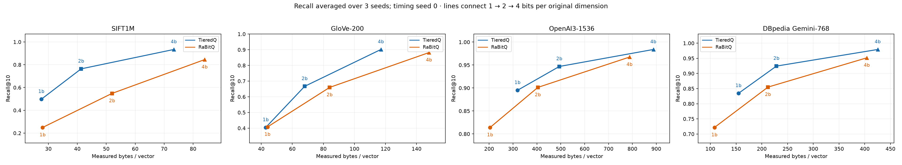
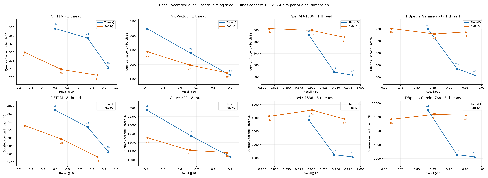
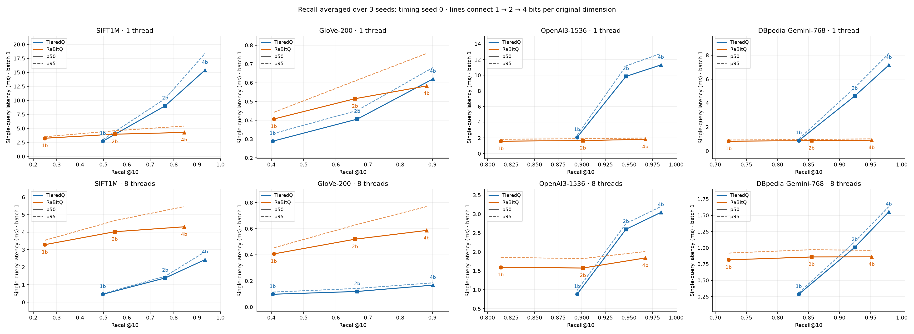

# Issue #4: fast-mode range-bound refresh

Four datasets; average code budgets 1/2/4 bits/dimension; 1/8 threads; batches 1/32; 1,000 queries; top-10. Recall uses seeds 0/1/2; timing uses seed 0 with three warmups and three repeats. Tables show seed-0 storage and timing, with population standard deviation across the three recall seeds. No reranking.

Fresh TieredQ and Gemini RaBitQ recall seeds 1/2 were run on Hartmut i9-7980XE, affinity CPUs 0–7. Saved RaBitQ seed-0 timings are from 2026-10-26; the first three datasets also reuse their saved recall seeds 1/2. Dataset array/truth hashes, native adapter and measurement hashes were checked. Between-run timing variation remains; the baseline reuse is explicit in row-provenance.json.

Gemini is 99,000 base / 1,000 disjoint held-out document queries, normalized cosine, 768D. Other datasets: SIFT 1M × 128 (L2), GloVe 100K × 200, OpenAI 100K × 1536 (normalized cosine).

## Primary serving point: 8 threads, batch 32

| Dataset | Codec | Bits | Recall@10 mean ± std | Bytes/vector | QPS |
|---|---|---:|---:|---:|---:|
| sift | tieredq | 1 | 0.4976 ± 0.0026 | 27.574 | 2,690 |
| sift | tieredq | 2 | 0.7639 ± 0.0014 | 41.320 | 2,270 |
| sift | tieredq | 4 | 0.9338 ± 0.0008 | 73.343 | 1,666 |
| sift | rabitq | 1 | 0.2495 ± 0.0047 | 28.001 | 2,307 |
| sift | rabitq | 2 | 0.5484 ± 0.0025 | 52.001 | 1,976 |
| sift | rabitq | 4 | 0.8450 ± 0.0030 | 84.001 | 1,535 |
| glove | tieredq | 1 | 0.4044 ± 0.0056 | 42.878 | 24,353 |
| glove | tieredq | 2 | 0.6665 ± 0.0038 | 67.939 | 16,931 |
| glove | tieredq | 4 | 0.9015 ± 0.0023 | 117.042 | 10,887 |
| glove | rabitq | 1 | 0.4078 ± 0.0020 | 44.012 | 16,371 |
| glove | rabitq | 2 | 0.6597 ± 0.0032 | 84.012 | 12,753 |
| glove | rabitq | 4 | 0.8818 ± 0.0008 | 148.012 | 12,131 |
| openai | tieredq | 1 | 0.8950 ± 0.0016 | 318.978 | 3,833 |
| openai | tieredq | 2 | 0.9468 ± 0.0004 | 493.905 | 1,234 |
| openai | tieredq | 4 | 0.9839 ± 0.0011 | 887.805 | 1,086 |
| openai | rabitq | 1 | 0.8140 ± 0.0014 | 204.070 | 4,118 |
| openai | rabitq | 2 | 0.9013 ± 0.0022 | 404.070 | 4,589 |
| openai | rabitq | 4 | 0.9674 ± 0.0007 | 788.070 | 3,917 |
| gemini | tieredq | 1 | 0.8344 ± 0.0006 | 154.759 | 9,015 |
| gemini | tieredq | 2 | 0.9243 ± 0.0009 | 228.472 | 2,552 |
| gemini | tieredq | 4 | 0.9792 ± 0.0009 | 425.247 | 2,253 |
| gemini | rabitq | 1 | 0.7216 ± 0.0034 | 108.044 | 7,675 |
| gemini | rabitq | 2 | 0.8549 ± 0.0017 | 212.044 | 8,394 |
| gemini | rabitq | 4 | 0.9516 ± 0.0006 | 404.044 | 8,284 |

## Range-bound control

The control build changes only the automatic checkpoint dispatch condition in src/tieredq_index.cpp. All 48 paired scheduling configurations produced identical top-10 IDs, recall and storage. Native range-checkpoint tests additionally cover surviving-score bit parity. The checkpoint dispatch is AVX-512, single-query only and requires a supported code-lookup layout with more than four tiers; batch-32 points are controls for timing variation, not bound speedup measurements.

| Dataset | Bits | Threads | Batch | Checkpoint active | Bounds/control QPS |
|---|---:|---:|---:|---|---:|
| sift | 1 | 1 | 1 | False | 1.00× |
| sift | 1 | 1 | 32 | False | 0.99× |
| sift | 1 | 8 | 1 | False | 1.16× |
| sift | 1 | 8 | 32 | False | 1.00× |
| sift | 2 | 1 | 1 | True | 1.35× |
| sift | 2 | 1 | 32 | False | 0.98× |
| sift | 2 | 8 | 1 | True | 1.29× |
| sift | 2 | 8 | 32 | False | 0.97× |
| sift | 4 | 1 | 1 | True | 1.49× |
| sift | 4 | 1 | 32 | False | 1.00× |
| sift | 4 | 8 | 1 | True | 1.33× |
| sift | 4 | 8 | 32 | False | 1.04× |
| glove | 1 | 1 | 1 | False | 1.00× |
| glove | 1 | 1 | 32 | False | 0.94× |
| glove | 1 | 8 | 1 | False | 0.99× |
| glove | 1 | 8 | 32 | False | 1.04× |
| glove | 2 | 1 | 1 | False | 0.99× |
| glove | 2 | 1 | 32 | False | 0.96× |
| glove | 2 | 8 | 1 | False | 0.98× |
| glove | 2 | 8 | 32 | False | 0.99× |
| glove | 4 | 1 | 1 | False | 1.04× |
| glove | 4 | 1 | 32 | False | 1.04× |
| glove | 4 | 8 | 1 | False | 1.04× |
| glove | 4 | 8 | 32 | False | 0.97× |
| openai | 1 | 1 | 1 | False | 0.98× |
| openai | 1 | 1 | 32 | False | 1.05× |
| openai | 1 | 8 | 1 | False | 0.99× |
| openai | 1 | 8 | 32 | False | 0.97× |
| openai | 2 | 1 | 1 | True | 1.30× |
| openai | 2 | 1 | 32 | False | 0.97× |
| openai | 2 | 8 | 1 | True | 1.15× |
| openai | 2 | 8 | 32 | False | 1.04× |
| openai | 4 | 1 | 1 | True | 1.39× |
| openai | 4 | 1 | 32 | False | 1.02× |
| openai | 4 | 8 | 1 | True | 1.17× |
| openai | 4 | 8 | 32 | False | 1.01× |
| gemini | 1 | 1 | 1 | False | 0.90× |
| gemini | 1 | 1 | 32 | False | 0.94× |
| gemini | 1 | 8 | 1 | False | 0.98× |
| gemini | 1 | 8 | 32 | False | 0.99× |
| gemini | 2 | 1 | 1 | True | 1.24× |
| gemini | 2 | 1 | 32 | False | 1.03× |
| gemini | 2 | 8 | 1 | True | 1.15× |
| gemini | 2 | 8 | 32 | False | 0.94× |
| gemini | 4 | 1 | 1 | True | 1.09× |
| gemini | 4 | 1 | 32 | False | 0.98× |
| gemini | 4 | 8 | 1 | True | 1.05× |
| gemini | 4 | 8 | 32 | False | 1.01× |

The measured grid cannot establish an optimum between budgets. Target recall 0.95 is reported only where a measured point reaches it; effective storage, rather than nominal bits alone, determines within-budget comparisons. See results.csv, summary.json, audit.json and ablation-summary.json.

Reproduction scripts and source.tar.gz are in the parent directory; remote-workspace.txt records the isolated remote job directory. Native tests and adapter validation logs are preserved in job.log and ablation.log. Compiler commands, source hashes, source revision and affinity are recorded in meta.json.
