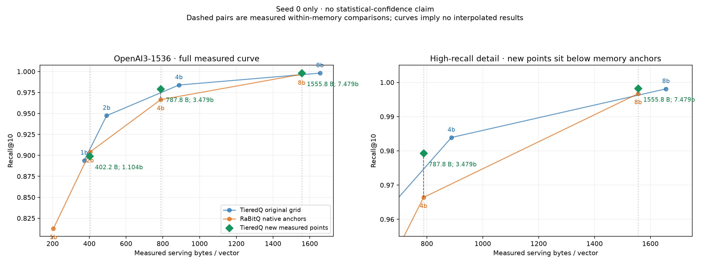

# OpenAI3-1536: additional memory-aligned TieredQ points

Three newly measured TieredQ fast-mode points sit within 0.5% below the current RaBitQ 2/4/8-bit serving-memory anchors. Full 100K base vectors, 1,000 held-out queries, seed 0, CPUs 0–7 on hartmut; threads 1/8 and batches 1/32, three warmup queries and three timing repeats. Single-seed results provide no statistical-confidence claim. RaBitQ rows are reused from the [completed current core run](../issue4-current-single-seed-20261026/README.md), not remeasured simultaneously. Native bounds/HACC remain enabled in those anchors.

The existing TieredQ total-code-bit API supports finer budgets than the original whole-bit CLI grid. A benchmark-only constructor overload exposes that API; codec source, precision and routing are unchanged. Storage-only calibration selects the first point under each anchor within 0.5%, without consulting recall. This is not an exhaustive search for an optimum or an exact-equal-memory claim. All calibration attempts are retained in `calibration.json`.

## Primary comparison

QPS is 8 threads/batch 32; construction includes training and encoding/packing. Encode throughput times native add/encode/pack. Serving storage is freshly measured as max(saved bytes, reloaded index/cache + serving model bytes). No historical memory totals are reused for the new points.

| RaBitQ bits | Codec | Code bits/vector | Nominal bits/dim | Bytes/vector | Recall@10 | QPS | Build s | Encode vectors/s |
|---:|---|---:|---:|---:|---:|---:|---:|---:|
| 2 | rabitq | 3072 | 2.0000 | 404.070 | 0.9041 | 4,589 | 2.502 | 40,733 |
| 2 | tieredq | 1695 | 1.1035 | 402.199 | 0.8991 | 3,759 | 14.075 | 99,269 |
| 4 | rabitq | 6144 | 4.0000 | 788.070 | 0.9664 | 3,917 | 4.146 | 24,405 |
| 4 | tieredq | 5344 | 3.4792 | 787.800 | 0.9793 | 1,106 | 15.575 | 48,775 |
| 8 | rabitq | 12288 | 8.0000 | 1556.070 | 0.9967 | 3,710 | 14.087 | 7,127 |
| 8 | tieredq | 11488 | 7.4792 | 1555.811 | 0.9982 | 960 | 21.953 | 12,659 |

## New single-query latencies

Batch 1, complete response latency in milliseconds.

| RaBitQ memory anchor | TieredQ bytes/vector | 1 thread p50 / p95 | 8 threads p50 / p95 |
|---:|---:|---:|---:|
| 404.070 | 402.199 | 1.966 / 2.207 | 0.850 / 0.921 |
| 788.070 | 787.800 | 14.914 / 16.588 | 3.443 / 3.613 |
| 1556.070 | 1555.811 | 38.937 / 42.963 | 7.640 / 8.152 |

## Measured outcome

- At the 404.070-byte anchor, TieredQ uses 0.463% less memory, has recall difference -0.0050, and 0.82× RaBitQ throughput. Separate-run timing variation is not quantified.
- At the 788.070-byte anchor, TieredQ uses 0.034% less memory, has recall difference +0.0129, and 0.28× RaBitQ throughput. Separate-run timing variation is not quantified.
- At the 1556.070-byte anchor, TieredQ uses 0.017% less memory, has recall difference +0.0015, and 0.26× RaBitQ throughput. Separate-run timing variation is not quantified.

## Why the 402-byte point trails RaBitQ

This continues the historical OpenAI pattern rather than showing a newly observed recall regression. The original issue #4 TieredQ 1-bit point used 375.762 bytes/vector for recall 0.8939, while RaBitQ 2-bit used 404.070 bytes/vector for recall 0.9041. The current original-grid TieredQ point uses 372.063 bytes/vector at the same recall; the new 402.199-byte point improves it to 0.8991.

At the new point, measured serving storage decomposes into 241.000 bytes/vector for the fast vector representation, 88.813 bytes/vector of additional fast-index/cache allocations, and 72.386 bytes/vector of reloaded serving model state. Total: 402.199. Shared/cache allocations are amortized over only 100K vectors. The nominal residual-code budget is 1,695 bits/vector (1.104 bits/dimension), allocated over 918 PCA ranks, whereas RaBitQ fits a nominal 2-bit representation at almost the same total memory. This explains why equal nominal-bit recall advantages cannot be assumed at equal serving memory; these measurements do not isolate every cause of the remaining recall difference.

Total supplemental wall time, including storage calibration and selected builds/searches: **346.10 s**. Selected construction plus all search measurements: **301.30 s**, excluding storage calibration, serialization/reload, compilation and dataset preparation. This supplemental time is separate from the original 1,076.91-second core matrix.

## Verification and reproduction

- `audit.json`: 12 unique rows, full original dataset manifest and base/query hashes, finite timings, invariant recall/storage/build/encode across scheduling rows, and every selected point within its measured RaBitQ anchor.
- `validation.log`: all 16 native validation tests pass. `meta.json` records all five audited compiler commands, native binary hash, affinity and exact selected budgets. Effective flags are `-O3 -march=native -ffp-contract=off`; nanobind uses `NOMINSIZE`.
- `source-sha256.json`, `exact-budget-binding.patch`, `provenance.json`: committed source is `3c9dbf5`; all codec source hashes match the core run. Fresh isolated build/environment at `sean@hartmut:/home/sean/experiments/TieredQ-openai-aligned-20261026-akXzMJ`. Historical workspaces and results remain intact.
- `run_aligned.py` and `setup-aligned.py` preserve the calibration and measurement procedure. Use the committed archive in the sibling core bundle, apply the binding patch, provide the verified caches, run `./validate.sh`, then run the driver with the native build on `PYTHONPATH`, CPUs 0–7 and BLAS threads fixed to one. No normal mode, seed sweep, kernel changes or profiling.

