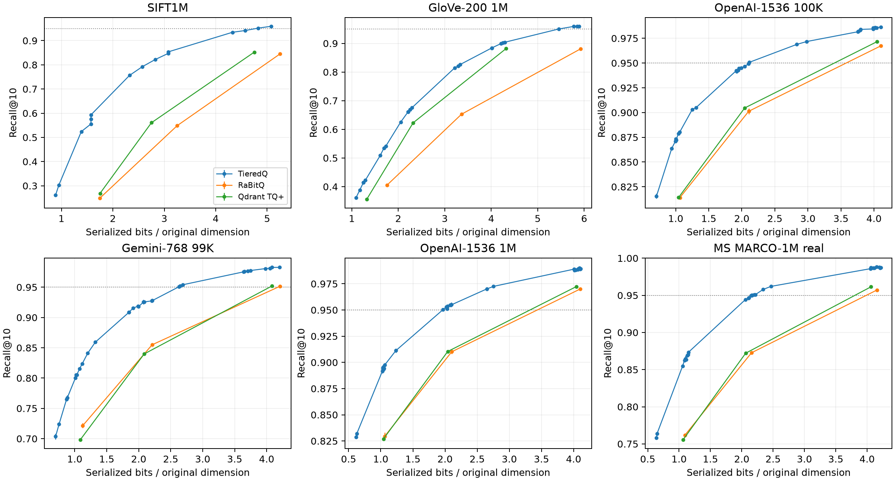
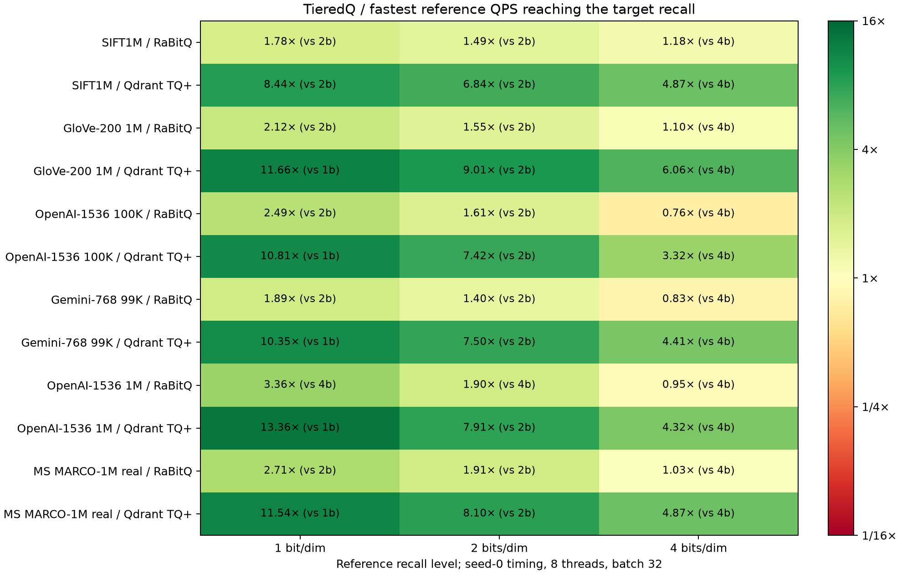

# TieredQ vs RaBitQ and Qdrant TQ+: current-main benchmark

Refreshed measurements for issue #4, library `c74b4e354b92d848a004e0f50199c3f7db7e0ca4`, six datasets, flat compressed top-10 search.
TieredQ uses its **default flat fast index, fine tiers enabled**, native L2 on SIFT and cosine elsewhere.
Fine tiers refine compressed candidates when the allocation uses wide tiers, typically from around
3 bits per original dimension; their preparation, scan and rescoring costs are included.
All TieredQ recall/memory cells were remeasured. Both references and every selected TieredQ budget were
retimed in an interleaved plan. The process stopped after 99 complete cells without an exit marker;
the remaining cells were resumed with unchanged binaries and settings. The interrupted cell was rerun,
and `timing/resume.json` records the interruption. [issue4-current-20261105 results and provenance](../benchmark/results/issue4-current-20261105/README.md).

Equal-memory accuracy (disk: 36/36 higher, Δ +1.42 to +34.37 points; ram: 36/36 higher, Δ +1.41 to +34.37 points; peak: 36/36 higher, Δ +1.01 to +27.46 points). Equal-recall QPS against each reference's fastest evaluated configuration
reaching the target: RaBitQ 1t·b32: 0.81–3.28×; RaBitQ 8t·b32: 0.76–3.36×; Qdrant TQ+ 1t·b32: 4.10–13.68×; Qdrant TQ+ 8t·b32: 3.32–13.36×. These ranges describe this host and adapter matrix.

## Answers to the four questions

1. **Accuracy and compression:** disk, steady serving RAM and peak serving RAM are matched separately below.
   The 0.95 table gives the smallest evaluated serialized storage with a three-seed mean reaching the target.
2. **Speed at equal recall:** selected budgets are confirmed on seeds 0–2 before timing; the speed table
   compares against each reference's fastest measured 1/2/4-bit configuration reaching that target.
3. **Build cost:** fresh-process build peaks, total build time and encoding throughput are reported below.
   The old report's build figures no longer describe this revision.
4. **Crossover at equal steady RAM:** vs RaBitQ at 1 bits/dim: faster in 6/6 datasets (8t·b32); vs RaBitQ at 2 bits/dim: faster in 5/6 datasets (8t·b32); vs RaBitQ at 4 bits/dim: faster in 0/6 datasets (8t·b32); vs Qdrant TQ+ at 1 bits/dim: faster in 6/6 datasets (8t·b32); vs Qdrant TQ+ at 2 bits/dim: faster in 6/6 datasets (8t·b32); vs Qdrant TQ+ at 4 bits/dim: faster in 6/6 datasets (8t·b32).
   The complete per-dataset rows below show losses as well as gains. Claims apply to the measured
   configurations, without extrapolating to IVF or SSD operation.

The benchmark took **11.98 hours** from preparation start through the final timing cell and diagnostic,
including builds, validation, calibration and interrupted attempts. This expanded run exceeded one hour; the under-one-hour acceptance is not met for this scope.

## Setup and measurement

| Dataset | Dimensions | Base | Queries | Metric |
|---|---:|---:|---:|---|
| SIFT1M | 128 | 1,000,000 | 1,000 | L2 |
| GloVe-200 | 200 | 1,000,000 | 1,000 | cosine |
| OpenAI-1536 100K | 1,536 | 100,000 | 1,000 | cosine |
| Gemini-768 | 768 | 99,000 | 1,000 | cosine |
| OpenAI-1536 1M | 1,536 | 999,000 | 1,000 | cosine |
| MS MARCO-1M | 1,024 | 1,000,000 | 1,000 | cosine, real dev questions |

Hartmut: Intel i9-7980XE, 18 physical cores, 62 GiB RAM. Native code uses `-O3 -march=native
-ffp-contract=off`; TieredQ's recorded fast-scan path is AVX-512, RaBitQ uses its native x86 SIMD
path, and Qdrant TQ+ its production AVX2
scorer through the preserved Rust shim. RaBitQ is pinned to `ced3763857e7e4e48553951bf66fabc8517bc4f0`,
direct flat FHT, implicit row IDs, high-accuracy scoring and native extra-bit bounds. Qdrant is pinned to
`222b2e44ab1c3f17e8246396ead6558e45041df7`, with seeded calibration and the existing adapter.
Exact compiler commands, source hashes, binary hashes, input hashes and process snapshots are in the bundle.

Data and exact FP32 truth were reused from cached prepared arrays. Missing SIFT/GloVe containers were
recovered from retained inputs; all three recovered arrays match the archived #4 hashes byte for byte.
SIFT truth was regenerated with the same exact algorithm and verified by its archived hash.
The primary GloVe base expands the original 100K subset to 1M cached source vectors, keeping
the same byte-identical queries and including every original base vector. Its exact FP32 truth
was recomputed. The original 100K results are retained below as a scaling appendix.
Recall@10 is mean ± sample standard
deviation over seeds 0–2; Qdrant's seeded calibration is fixed across those benchmark seeds. Reference
recall/storage cells were reused only after source and provenance checks; fresh seed-0 reference builds
verify identical recall and serialized bytes. Their timing and build costs are refreshed here.
GloVe-1M reference cells were measured fresh on all three seeds, without reusing 100K measurements.

Matching and recall searches use CPUs 8–31 in three lanes; timing follows after all lanes exit, on CPUs
0–7, with their SMT siblings 18–25 free of benchmark work. Timing uses seed 0, threads 1/8 × batches 1/32,
1,000 queries, three warmup calls and three complete repeats.
Builds use eight codec threads with BLAS restricted to one thread. Cosine inputs are cached, normalized
FP32 vectors; data loading, embedding generation and dataset preparation are outside search timing.
End-to-end search includes query preparation, scan, fine-tier rescoring when enabled, and top-k.
Batch-1 p50/p95 measure single-query response latency;
batch-32 latency is a batch response time, not per-query amortized latency. No FP32 reranking is used.

Serialized bytes include headers, model/shared state, metadata and padding. Effective bytes/vector = total
bytes / N; bits/vector = eight times that; compression versus FP32 = 32d / measured bits/vector.
Steady and peak serving RAM are RSS growth from before reload; peak is the maximum over reload and all
four serving schedules. The raw diagnostics also retain absolute process RSS. Build time covers training,
encoding and packing, excluding data loading, truth generation and the explicit serialization pass.
Qdrant's native constructor also writes its required output metadata/codes, so its build time includes
that work. Build peak growth excludes
the already-loaded FP32 corpus; absolute build process peak includes it. Both are reported, measured in a
fresh process. Encoding throughput uses each codec adapter's encoding interval.

Each equal-memory target is the minimum reference storage across seeds. TieredQ is calibrated using seed-0
storage only, then confirmed on all three seeds, stepping downward if necessary. Its maximum across seeds
must fit. The 1/2/4-bit labels identify reference code widths; matching uses measured serialized bytes
or RSS, never nominal code bits alone. Packing discontinuities and RSS noise can leave unused budget;
the supplementary tables show both actual usages. Disk-matched, steady-RAM-matched and peak-RAM-matched
rows are separate comparisons and can select different TieredQ budgets.
Equal-recall bisection explores seed 0, then budgets step upward until the three-seed mean reaches
the reference. Near-monotonicity is an empirical search assumption; “smallest evaluated” is not a proof of
a global minimum. Reference storage at 0.95 is limited to the evaluated 1/2/4-bit configurations.

## Accuracy at equal memory

TieredQ columns show mean ± std and Δ recall points versus the reference. All three resource targets
are distinct; complete target budgets and bytes are in [the supplementary tables](../benchmark/results/issue4-current-20261105/tables.md).

| Dataset | Reference | Reference nominal bits/dim | Reference R@10 | TieredQ disk (Δ pt) | TieredQ steady RAM (Δ pt) | TieredQ peak RAM (Δ pt) |
| --- | --- | --- | --- | --- | --- | --- |
| SIFT1M | RaBitQ | 1 | 0.2495 ± 0.0058 | 0.5932 ± 0.0004 (+34.37) | 0.5932 ± 0.0004 (+34.37) | 0.5241 ± 0.0038 (+27.46) |
| SIFT1M | RaBitQ | 2 | 0.5484 ± 0.0031 | 0.8534 ± 0.0011 (+30.50) | 0.8534 ± 0.0011 (+30.50) | 0.8220 ± 0.0009 (+27.36) |
| SIFT1M | RaBitQ | 4 | 0.8450 ± 0.0037 | 0.9592 ± 0.0011 (+11.42) | 0.9592 ± 0.0011 (+11.42) | 0.9517 ± 0.0017 (+10.66) |
| SIFT1M | Qdrant TQ+ | 1 | 0.2685 ± 0.0000 | 0.5932 ± 0.0004 (+32.47) | 0.5932 ± 0.0004 (+32.47) | 0.5241 ± 0.0038 (+25.56) |
| SIFT1M | Qdrant TQ+ | 2 | 0.5606 ± 0.0000 | 0.7925 ± 0.0007 (+23.19) | 0.7925 ± 0.0007 (+23.19) | 0.7564 ± 0.0023 (+19.58) |
| SIFT1M | Qdrant TQ+ | 4 | 0.8525 ± 0.0000 | 0.9418 ± 0.0025 (+8.93) | 0.9418 ± 0.0025 (+8.93) | 0.9345 ± 0.0024 (+8.20) |
| GloVe-200 1M | RaBitQ | 1 | 0.4057 ± 0.0009 | 0.5413 ± 0.0008 (+13.57) | 0.5349 ± 0.0058 (+12.92) | 0.5089 ± 0.0016 (+10.32) |
| GloVe-200 1M | RaBitQ | 2 | 0.6526 ± 0.0026 | 0.8262 ± 0.0013 (+17.36) | 0.8213 ± 0.0031 (+16.87) | 0.8143 ± 0.0010 (+16.16) |
| GloVe-200 1M | RaBitQ | 4 | 0.8806 ± 0.0015 | 0.9593 ± 0.0010 (+7.87) | 0.9595 ± 0.0010 (+7.89) | 0.9591 ± 0.0008 (+7.85) |
| GloVe-200 1M | Qdrant TQ+ | 1 | 0.3556 ± 0.0000 | 0.4224 ± 0.0021 (+6.68) | 0.4151 ± 0.0018 (+5.95) | 0.3882 ± 0.0047 (+3.26) |
| GloVe-200 1M | Qdrant TQ+ | 2 | 0.6228 ± 0.0000 | 0.6750 ± 0.0001 (+5.22) | 0.6684 ± 0.0051 (+4.56) | 0.6613 ± 0.0034 (+3.85) |
| GloVe-200 1M | Qdrant TQ+ | 4 | 0.8818 ± 0.0000 | 0.9039 ± 0.0021 (+2.21) | 0.9021 ± 0.0009 (+2.03) | 0.8994 ± 0.0020 (+1.76) |
| OpenAI-1536 100K | RaBitQ | 1 | 0.8140 ± 0.0018 | 0.8804 ± 0.0008 (+6.64) | 0.8710 ± 0.0016 (+5.70) | 0.8637 ± 0.0018 (+4.97) |
| OpenAI-1536 100K | RaBitQ | 2 | 0.9013 ± 0.0027 | 0.9491 ± 0.0010 (+4.79) | 0.9466 ± 0.0014 (+4.53) | 0.9428 ± 0.0013 (+4.16) |
| OpenAI-1536 100K | RaBitQ | 4 | 0.9674 ± 0.0008 | 0.9865 ± 0.0009 (+1.91) | 0.9859 ± 0.0008 (+1.86) | 0.9834 ± 0.0020 (+1.60) |
| OpenAI-1536 100K | Qdrant TQ+ | 1 | 0.8142 ± 0.0000 | 0.8787 ± 0.0001 (+6.45) | 0.8710 ± 0.0016 (+5.68) | 0.8637 ± 0.0018 (+4.95) |
| OpenAI-1536 100K | Qdrant TQ+ | 2 | 0.9046 ± 0.0000 | 0.9466 ± 0.0014 (+4.20) | 0.9450 ± 0.0011 (+4.04) | 0.9424 ± 0.0014 (+3.78) |
| OpenAI-1536 100K | Qdrant TQ+ | 4 | 0.9715 ± 0.0000 | 0.9857 ± 0.0005 (+1.42) | 0.9856 ± 0.0008 (+1.41) | 0.9816 ± 0.0007 (+1.01) |
| Gemini-768 99K | RaBitQ | 1 | 0.7216 ± 0.0042 | 0.8239 ± 0.0011 (+10.23) | 0.8005 ± 0.0027 (+7.89) | 0.7651 ± 0.0022 (+4.35) |
| Gemini-768 99K | RaBitQ | 2 | 0.8549 ± 0.0021 | 0.9274 ± 0.0021 (+7.25) | 0.9255 ± 0.0037 (+7.05) | 0.9156 ± 0.0009 (+6.07) |
| Gemini-768 99K | RaBitQ | 4 | 0.9516 ± 0.0008 | 0.9827 ± 0.0014 (+3.12) | 0.9814 ± 0.0018 (+2.98) | 0.9764 ± 0.0027 (+2.49) |
| Gemini-768 99K | Qdrant TQ+ | 1 | 0.6980 ± 0.0000 | 0.8154 ± 0.0025 (+11.74) | 0.8005 ± 0.0027 (+10.25) | 0.7651 ± 0.0022 (+6.71) |
| Gemini-768 99K | Qdrant TQ+ | 2 | 0.8398 ± 0.0000 | 0.9256 ± 0.0009 (+8.58) | 0.9186 ± 0.0025 (+7.88) | 0.9086 ± 0.0020 (+6.88) |
| Gemini-768 99K | Qdrant TQ+ | 4 | 0.9521 ± 0.0000 | 0.9827 ± 0.0010 (+3.06) | 0.9807 ± 0.0017 (+2.86) | 0.9753 ± 0.0014 (+2.32) |
| OpenAI-1536 1M | RaBitQ | 1 | 0.8296 ± 0.0035 | 0.8975 ± 0.0017 (+6.80) | 0.8943 ± 0.0022 (+6.47) | 0.8936 ± 0.0005 (+6.40) |
| OpenAI-1536 1M | RaBitQ | 2 | 0.9101 ± 0.0019 | 0.9550 ± 0.0021 (+4.48) | 0.9551 ± 0.0006 (+4.50) | 0.9548 ± 0.0009 (+4.46) |
| OpenAI-1536 1M | RaBitQ | 4 | 0.9701 ± 0.0006 | 0.9890 ± 0.0007 (+1.90) | 0.9902 ± 0.0012 (+2.02) | 0.9888 ± 0.0002 (+1.87) |
| OpenAI-1536 1M | Qdrant TQ+ | 1 | 0.8270 ± 0.0000 | 0.8953 ± 0.0017 (+6.83) | 0.8938 ± 0.0017 (+6.68) | 0.8916 ± 0.0019 (+6.46) |
| OpenAI-1536 1M | Qdrant TQ+ | 2 | 0.9104 ± 0.0000 | 0.9537 ± 0.0005 (+4.33) | 0.9511 ± 0.0010 (+4.07) | 0.9531 ± 0.0004 (+4.27) |
| OpenAI-1536 1M | Qdrant TQ+ | 4 | 0.9723 ± 0.0000 | 0.9881 ± 0.0003 (+1.58) | 0.9882 ± 0.0010 (+1.59) | 0.9890 ± 0.0008 (+1.67) |
| MS MARCO-1M real | RaBitQ | 1 | 0.7619 ± 0.0018 | 0.8627 ± 0.0020 (+10.08) | 0.8702 ± 0.0013 (+10.84) | 0.8692 ± 0.0028 (+10.74) |
| MS MARCO-1M real | RaBitQ | 2 | 0.8727 ± 0.0010 | 0.9500 ± 0.0007 (+7.73) | 0.9496 ± 0.0009 (+7.69) | 0.9511 ± 0.0006 (+7.84) |
| MS MARCO-1M real | RaBitQ | 4 | 0.9571 ± 0.0008 | 0.9884 ± 0.0003 (+3.13) | 0.9870 ± 0.0011 (+2.99) | 0.9876 ± 0.0007 (+3.05) |
| MS MARCO-1M real | Qdrant TQ+ | 1 | 0.7554 ± 0.0000 | 0.8546 ± 0.0006 (+9.92) | 0.8637 ± 0.0003 (+10.83) | 0.8647 ± 0.0041 (+10.93) |
| MS MARCO-1M real | Qdrant TQ+ | 2 | 0.8721 ± 0.0000 | 0.9443 ± 0.0010 (+7.22) | 0.9467 ± 0.0015 (+7.46) | 0.9463 ± 0.0011 (+7.42) |
| MS MARCO-1M real | Qdrant TQ+ | 4 | 0.9615 ± 0.0000 | 0.9859 ± 0.0012 (+2.44) | 0.9870 ± 0.0012 (+2.55) | 0.9866 ± 0.0003 (+2.51) |

## Smallest evaluated storage at Recall@10 ≥ 0.95

All rows require three measured seeds. Budgets are code bits for TieredQ and bits/dim for references.

| Dataset | Codec | Budget | Disk bits/vector | Bytes/vector | FP32 compression | Recall@10 |
| --- | --- | --- | --- | --- | --- | --- |
| SIFT1M | TieredQ | 576 | 617.6 | 77.20 | 6.63× | 0.9517 ± 0.0017 |
| SIFT1M | RaBitQ | unreached | — | — | — | best 0.8450 |
| SIFT1M | Qdrant TQ+ | unreached | — | — | — | best 0.8525 |
| GloVe-200 1M | TieredQ | 1051 | 1090.5 | 136.31 | 5.87× | 0.9501 ± 0.0022 |
| GloVe-200 1M | RaBitQ | unreached | — | — | — | best 0.8806 |
| GloVe-200 1M | Qdrant TQ+ | unreached | — | — | — | best 0.8818 |
| OpenAI-1536 100K | TieredQ | 2810 | 3245.6 | 405.70 | 15.14× | 0.9507 ± 0.0011 |
| OpenAI-1536 100K | RaBitQ | 4 | 6304.6 | 788.07 | 7.80× | 0.9674 ± 0.0008 |
| OpenAI-1536 100K | Qdrant TQ+ | 4 | 6210.6 | 776.33 | 7.91× | 0.9715 ± 0.0000 |
| Gemini-768 99K | TieredQ | 1842 | 2017.9 | 252.23 | 12.18× | 0.9506 ± 0.0026 |
| Gemini-768 99K | RaBitQ | 4 | 3232.4 | 404.04 | 7.60× | 0.9516 ± 0.0008 |
| Gemini-768 99K | Qdrant TQ+ | 4 | 3137.3 | 392.16 | 7.83× | 0.9521 ± 0.0000 |
| OpenAI-1536 1M | TieredQ | 2946 | 3024.9 | 378.11 | 16.25× | 0.9504 ± 0.0009 |
| OpenAI-1536 1M | RaBitQ | 4 | 6304.1 | 788.01 | 7.80× | 0.9701 ± 0.0006 |
| OpenAI-1536 1M | Qdrant TQ+ | 4 | 6208.3 | 776.03 | 7.92× | 0.9723 ± 0.0000 |
| MS MARCO-1M real | TieredQ | 2152 | 2211.9 | 276.49 | 14.81× | 0.9503 ± 0.0020 |
| MS MARCO-1M real | RaBitQ | 4 | 4256.0 | 532.00 | 7.70× | 0.9571 ± 0.0008 |
| MS MARCO-1M real | Qdrant TQ+ | 4 | 4160.2 | 520.02 | 7.88× | 0.9615 ± 0.0000 |

At the 0.95 target, TieredQ uses that smallest evaluated storage point. Reference QPS uses the fastest measured budget/schedule reaching at least 0.95; batch-1 p50 uses the best thread setting at TieredQ’s selected budget and across eligible reference budgets. Reference recall can overshoot 0.95 because only 1/2/4-bit configurations are evaluated.

| Dataset | Reference | TieredQ code bits | Best QPS TQ / ref | QPS schedules TQ / ref | Best batch-1 p50 ms TQ / ref |
| --- | --- | --- | --- | --- | --- |
| SIFT1M | RaBitQ | 576 | reference unreached | — | — |
| SIFT1M | Qdrant TQ+ | 576 | reference unreached | — | — |
| GloVe-200 1M | RaBitQ | 1051 | reference unreached | — | — |
| GloVe-200 1M | Qdrant TQ+ | 1051 | reference unreached | — | — |
| OpenAI-1536 100K | RaBitQ | 2810 | 4608 / 3717 (1.24×) | 8t·b32 / 4b 8t·b32 | 0.716 / 1.848 |
| OpenAI-1536 100K | Qdrant TQ+ | 2810 | 4608 / 815 (5.66×) | 8t·b32 / 4b 8t·b32 | 0.716 / 9.708 |
| Gemini-768 99K | RaBitQ | 1842 | 6579 / 8199 (0.80×) | 8t·b32 / 4b 8t·b32 | 0.338 / 0.851 |
| Gemini-768 99K | Qdrant TQ+ | 1842 | 6579 / 1478 (4.45×) | 8t·b32 / 4b 8t·b32 | 0.338 / 5.204 |
| OpenAI-1536 1M | RaBitQ | 2946 | 492 / 391 (1.26×) | 8t·b32 / 4b 8t·b32 | 5.051 / 18.989 |
| OpenAI-1536 1M | Qdrant TQ+ | 2946 | 492 / 82 (5.98×) | 8t·b32 / 4b 8t·b32 | 5.051 / 97.576 |
| MS MARCO-1M real | RaBitQ | 2152 | 623 / 574 (1.09×) | 8t·b32 / 4b 8t·b32 | 3.785 / 12.932 |
| MS MARCO-1M real | Qdrant TQ+ | 2152 | 623 / 116 (5.37×) | 8t·b32 / 4b 8t·b32 | 3.785 / 67.705 |

## Speed at equal steady serving RAM

QPS is 8 threads, batch 32; p50 is 1 thread, batch 1. Values are TieredQ / reference.

| Dataset | Reference | bits/dim | TieredQ code bits | QPS (ratio) | p50 ms |
| --- | --- | --- | --- | --- | --- |
| SIFT1M | RaBitQ | 1 | 160 | 2899 / 1905 (1.52×) | 7.814 / 3.750 |
| SIFT1M | RaBitQ | 2 | 352 | 2089 / 2060 (1.01×) | 14.096 / 3.810 |
| SIFT1M | RaBitQ | 4 | 608 | 1703 / 1778 (0.96×) | 21.638 / 4.091 |
| SIFT1M | Qdrant TQ+ | 1 | 160 | 2899 / 270 (10.75×) | 7.814 / 27.391 |
| SIFT1M | Qdrant TQ+ | 2 | 285 | 2247 / 442 (5.09×) | 10.992 / 17.420 |
| SIFT1M | Qdrant TQ+ | 4 | 538 | 1747 / 429 (4.07×) | 17.885 / 18.144 |
| GloVe-200 1M | RaBitQ | 1 | 292 | 2478 / 1249 (1.98×) | 4.593 / 5.662 |
| GloVe-200 1M | RaBitQ | 2 | 619 | 1725 / 1382 (1.25×) | 7.944 / 5.572 |
| GloVe-200 1M | RaBitQ | 4 | 1131 | 1114 / 1354 (0.82×) | 12.908 / 5.685 |
| GloVe-200 1M | Qdrant TQ+ | 1 | 199 | 2852 / 266 (10.71×) | 3.784 / 27.212 |
| GloVe-200 1M | Qdrant TQ+ | 2 | 408 | 2162 / 256 (8.45×) | 5.282 / 30.033 |
| GloVe-200 1M | Qdrant TQ+ | 4 | 813 | 1427 / 249 (5.74×) | 9.772 / 31.031 |
| OpenAI-1536 100K | RaBitQ | 1 | 1205 | 9003 / 4159 (2.16×) | 1.117 / 1.655 |
| OpenAI-1536 100K | RaBitQ | 2 | 2709 | 4701 / 4560 (1.03×) | 2.462 / 1.561 |
| OpenAI-1536 100K | RaBitQ | 4 | 5620 | 2044 / 3717 (0.55×) | 5.513 / 1.860 |
| OpenAI-1536 100K | Qdrant TQ+ | 1 | 1205 | 9003 / 1049 (8.58×) | 1.117 / 7.342 |
| OpenAI-1536 100K | Qdrant TQ+ | 2 | 2639 | 4908 / 953 (5.15×) | 2.424 / 8.319 |
| OpenAI-1536 100K | Qdrant TQ+ | 4 | 5570 | 2076 / 815 (2.55×) | 5.440 / 9.708 |
| Gemini-768 99K | RaBitQ | 1 | 630 | 15683 / 8249 (1.90×) | 0.582 / 0.857 |
| Gemini-768 99K | RaBitQ | 2 | 1421 | 8358 / 8843 (0.95×) | 1.079 / 0.827 |
| Gemini-768 99K | RaBitQ | 4 | 2917 | 3793 / 8199 (0.46×) | 2.657 / 0.851 |
| Gemini-768 99K | Qdrant TQ+ | 1 | 630 | 15683 / 1795 (8.74×) | 0.582 / 4.284 |
| Gemini-768 99K | Qdrant TQ+ | 2 | 1352 | 8617 / 1759 (4.90×) | 1.076 / 4.503 |
| Gemini-768 99K | Qdrant TQ+ | 4 | 2862 | 3965 / 1478 (2.68×) | 2.616 / 5.242 |
| OpenAI-1536 1M | RaBitQ | 1 | 1540 | 845 / 373 (2.26×) | 16.043 / 19.769 |
| OpenAI-1536 1M | RaBitQ | 2 | 3129 | 456 / 386 (1.18×) | 26.812 / 18.996 |
| OpenAI-1536 1M | RaBitQ | 4 | 6197 | 250 / 391 (0.64×) | 56.386 / 18.989 |
| OpenAI-1536 1M | Qdrant TQ+ | 1 | 1507 | 877 / 99 (8.84×) | 15.115 / 74.223 |
| OpenAI-1536 1M | Qdrant TQ+ | 2 | 3040 | 482 / 94 (5.12×) | 24.592 / 85.552 |
| OpenAI-1536 1M | Qdrant TQ+ | 4 | 6091 | 255 / 82 (3.09×) | 54.404 / 97.576 |
| MS MARCO-1M real | RaBitQ | 1 | 1108 | 1100 / 532 (2.07×) | 12.203 / 13.801 |
| MS MARCO-1M real | RaBitQ | 2 | 2145 | 634 / 574 (1.11×) | 21.288 / 12.882 |
| MS MARCO-1M real | RaBitQ | 4 | 4239 | 364 / 574 (0.64×) | 37.817 / 12.932 |
| MS MARCO-1M real | Qdrant TQ+ | 1 | 1079 | 1124 / 148 (7.59×) | 12.121 / 52.848 |
| MS MARCO-1M real | Qdrant TQ+ | 2 | 2106 | 665 / 135 (4.92×) | 20.928 / 58.368 |
| MS MARCO-1M real | Qdrant TQ+ | 4 | 4150 | 367 / 116 (3.16×) | 37.925 / 67.705 |

## Speed and storage at equal recall

QPS ratios use the fastest reference budget reaching each target separately for each schedule; the selected reference bits/dim are in parentheses. p50 uses the fastest eligible reference budget at 1t·b1.

| Dataset | Reference | bits/dim | Reference / TieredQ R@10 | TQ code bits | Disk bits/vector TQ / ref | QPS ratio 1t·b32 | QPS ratio 8t·b32 | p50 1t·b1 ms TQ / fastest eligible ref |
| --- | --- | --- | --- | --- | --- | --- | --- | --- |
| SIFT1M | RaBitQ | 1 | 0.2495 / 0.2614 ± 0.0016 | 66 | 113.4 / 224.0 (0.51×) | 1.93× (1b) | 1.78× (2b) | 2.005 / 3.750 (1b) |
| SIFT1M | RaBitQ | 2 | 0.5484 / 0.5555 ± 0.0022 | 146 | 201.5 / 416.0 (0.48×) | 1.80× (2b) | 1.49× (2b) | 8.234 / 3.810 (2b) |
| SIFT1M | RaBitQ | 4 | 0.8450 / 0.8470 ± 0.0018 | 344 | 393.6 / 672.0 (0.59×) | 1.30× (4b) | 1.18× (4b) | 14.486 / 4.091 (4b) |
| SIFT1M | Qdrant TQ+ | 1 | 0.2685 / 0.3024 ± 0.0028 | 74 | 121.4 / 224.0 (0.54×) | 8.87× (2b) | 8.44× (2b) | 2.060 / 17.420 (2b) |
| SIFT1M | Qdrant TQ+ | 2 | 0.5606 / 0.5757 ± 0.0008 | 154 | 201.5 / 352.0 (0.57×) | 8.31× (2b) | 6.84× (2b) | 7.827 / 17.420 (2b) |
| SIFT1M | Qdrant TQ+ | 4 | 0.8525 / 0.8534 ± 0.0011 | 352 | 393.6 / 608.0 (0.65×) | 5.73× (4b) | 4.87× (4b) | 14.096 / 18.144 (4b) |
| GloVe-200 1M | RaBitQ | 1 | 0.4057 / 0.4151 ± 0.0018 | 204 | 250.3 / 352.0 (0.71×) | 2.24× (2b) | 2.12× (2b) | 3.781 / 5.572 (2b) |
| GloVe-200 1M | RaBitQ | 2 | 0.6526 / 0.6613 ± 0.0034 | 391 | 442.4 / 672.0 (0.66×) | 1.66× (2b) | 1.55× (2b) | 5.300 / 5.572 (2b) |
| GloVe-200 1M | RaBitQ | 4 | 0.8806 / 0.8841 ± 0.0024 | 758 | 802.5 / 1184.0 (0.68×) | 1.16× (4b) | 1.10× (4b) | 9.311 / 5.685 (4b) |
| GloVe-200 1M | Qdrant TQ+ | 1 | 0.3556 / 0.3615 ± 0.0023 | 171 | 218.3 / 264.0 (0.83×) | 11.53× (1b) | 11.66× (1b) | 3.682 / 27.212 (1b) |
| GloVe-200 1M | Qdrant TQ+ | 2 | 0.6228 / 0.6253 ± 0.0039 | 359 | 410.4 / 464.0 (0.88×) | 9.45× (2b) | 9.01× (2b) | 5.234 / 30.033 (2b) |
| GloVe-200 1M | Qdrant TQ+ | 4 | 0.8818 / 0.8841 ± 0.0024 | 756 | 802.5 / 864.0 (0.93×) | 6.19× (4b) | 6.06× (4b) | 9.266 / 31.031 (4b) |
| OpenAI-1536 100K | RaBitQ | 1 | 0.8140 / 0.8156 ± 0.0026 | 794 | 1089.5 / 1632.6 (0.67×) | 2.59× (2b) | 2.49× (2b) | 0.774 / 1.561 (2b) |
| OpenAI-1536 100K | RaBitQ | 2 | 0.9013 / 0.9031 ± 0.0009 | 1570 | 1921.5 / 3232.6 (0.59×) | 1.60× (2b) | 1.61× (2b) | 1.366 / 1.561 (2b) |
| OpenAI-1536 100K | RaBitQ | 4 | 0.9674 / 0.9688 ± 0.0007 | 3846 | 4348.2 / 6304.6 (0.69×) | 0.81× (4b) | 0.76× (4b) | 3.871 / 1.860 (4b) |
| OpenAI-1536 100K | Qdrant TQ+ | 1 | 0.8142 / 0.8156 ± 0.0026 | 794 | 1089.5 / 1602.6 (0.68×) | 12.91× (1b) | 10.81× (1b) | 0.774 / 7.342 (1b) |
| OpenAI-1536 100K | Qdrant TQ+ | 2 | 0.9046 / 0.9050 ± 0.0004 | 1652 | 2009.4 / 3138.6 (0.64×) | 8.38× (2b) | 7.42× (2b) | 1.397 / 8.319 (2b) |
| OpenAI-1536 100K | Qdrant TQ+ | 4 | 0.9715 / 0.9717 ± 0.0001 | 4068 | 4583.0 / 6210.6 (0.74×) | 4.10× (4b) | 3.32× (4b) | 4.051 / 9.708 (4b) |
| Gemini-768 99K | RaBitQ | 1 | 0.7216 / 0.7237 ± 0.0026 | 436 | 579.3 / 864.4 (0.67×) | 2.21× (2b) | 1.89× (2b) | 0.481 / 0.827 (2b) |
| Gemini-768 99K | RaBitQ | 2 | 0.8549 / 0.8592 ± 0.0002 | 860 | 1014.7 / 1696.4 (0.60×) | 1.47× (2b) | 1.40× (2b) | 0.706 / 0.827 (2b) |
| Gemini-768 99K | RaBitQ | 4 | 0.9516 / 0.9519 ± 0.0006 | 1858 | 2034.2 / 3232.4 (0.63×) | 0.83× (4b) | 0.83× (4b) | 1.468 / 0.851 (4b) |
| Gemini-768 99K | Qdrant TQ+ | 1 | 0.6980 / 0.7036 ± 0.0048 | 398 | 538.0 / 833.3 (0.65×) | 11.46× (1b) | 10.35× (1b) | 0.466 / 4.284 (1b) |
| Gemini-768 99K | Qdrant TQ+ | 2 | 0.8398 / 0.8411 ± 0.0024 | 770 | 923.9 / 1601.3 (0.58×) | 8.48× (2b) | 7.50× (2b) | 0.682 / 4.503 (2b) |
| Gemini-768 99K | Qdrant TQ+ | 4 | 0.9521 / 0.9541 ± 0.0022 | 1890 | 2066.9 / 3137.3 (0.66×) | 4.88× (4b) | 4.41× (4b) | 1.554 / 5.242 (4b) |
| OpenAI-1536 1M | RaBitQ | 1 | 0.8296 / 0.8318 ± 0.0021 | 892 | 961.9 / 1632.1 (0.59×) | 3.28× (4b) | 3.36× (4b) | 10.015 / 18.989 (4b) |
| OpenAI-1536 1M | RaBitQ | 2 | 0.9101 / 0.9112 ± 0.0020 | 1820 | 1897.0 / 3232.1 (0.59×) | 1.89× (4b) | 1.90× (4b) | 18.461 / 18.989 (4b) |
| OpenAI-1536 1M | RaBitQ | 4 | 0.9701 / 0.9701 ± 0.0017 | 3986 | 4071.0 / 6304.1 (0.65×) | 0.95× (4b) | 0.95× (4b) | 33.367 / 18.989 (4b) |
| OpenAI-1536 1M | Qdrant TQ+ | 1 | 0.8270 / 0.8286 ± 0.0013 | 874 | 945.7 / 1600.3 (0.59×) | 13.68× (1b) | 13.36× (1b) | 9.846 / 74.223 (1b) |
| OpenAI-1536 1M | Qdrant TQ+ | 2 | 0.9104 / 0.9112 ± 0.0020 | 1820 | 1897.0 / 3136.3 (0.60×) | 8.24× (2b) | 7.91× (2b) | 18.461 / 85.552 (2b) |
| OpenAI-1536 1M | Qdrant TQ+ | 4 | 0.9723 / 0.9725 ± 0.0003 | 4140 | 4231.8 / 6208.3 (0.68×) | 4.66× (4b) | 4.32× (4b) | 34.761 / 97.576 (4b) |
| MS MARCO-1M real | RaBitQ | 1 | 0.7619 / 0.7636 ± 0.0025 | 602 | 663.1 / 1120.0 (0.59×) | 2.66× (2b) | 2.71× (2b) | 7.126 / 12.882 (2b) |
| MS MARCO-1M real | RaBitQ | 2 | 0.8727 / 0.8733 ± 0.0026 | 1114 | 1177.0 / 2208.0 (0.53×) | 1.89× (2b) | 1.91× (2b) | 12.018 / 12.882 (2b) |
| MS MARCO-1M real | RaBitQ | 4 | 0.9571 / 0.9579 ± 0.0021 | 2336 | 2396.4 / 4256.0 (0.56×) | 1.03× (4b) | 1.03× (4b) | 23.663 / 12.932 (4b) |
| MS MARCO-1M real | Qdrant TQ+ | 1 | 0.7554 / 0.7583 ± 0.0011 | 594 | 655.1 / 1088.2 (0.60×) | 13.02× (1b) | 11.54× (1b) | 7.057 / 52.848 (1b) |
| MS MARCO-1M real | Qdrant TQ+ | 2 | 0.8721 / 0.8733 ± 0.0026 | 1114 | 1177.0 / 2112.2 (0.56×) | 8.44× (2b) | 8.10× (2b) | 12.018 / 58.368 (2b) |
| MS MARCO-1M real | Qdrant TQ+ | 4 | 0.9615 / 0.9620 ± 0.0004 | 2464 | 2524.7 / 4160.2 (0.61×) | 5.10× (4b) | 4.87× (4b) | 23.774 / 67.705 (4b) |

## Query preparation cost

A separate diagnostic adapter replays each codec’s native query preparation on the same reloaded index, without scanning or top-k. It runs after headline timing and checks identical search IDs for 32 queries. The measured library and production Qdrant shim remain unchanged. Diagnostic time includes adapter call overhead; isolated replay has different cache behavior from a full scan, so percentages are diagnostic estimates. batch figures are divided by query count only for this decomposition, not reported as response latency. The table summarizes configurations where preparation exceeds 10% of end-to-end mean time; all configurations and four schedules are retained in `preparation.csv`.

| Dataset | Codec | Configurations/schedules >10% | Preparation ms/query | Share of mean end-to-end |
| --- | --- | --- | --- | --- |
| GloVe-200 1M | TieredQ | 1 | 0.0348–0.0348 | 10.8–10.8% |
| OpenAI-1536 100K | TieredQ | 41 | 0.0139–0.3006 | 10.0–55.4% |
| OpenAI-1536 100K | RaBitQ | 1 | 0.0295–0.0295 | 11.0–11.0% |
| Gemini-768 99K | TieredQ | 31 | 0.0058–0.1070 | 10.1–37.0% |

## Build cost

Build time and encode throughput come from seed-0 builds in the serialized timing session. Memory ranges cover fresh-process evaluated TieredQ budgets/seeds, including calibration and equal-recall configurations; reference memory ranges cover fresh seed-0 builds at 1/2/4 bits/dim. RSS growth and absolute process peak are in bits per vector. These are build-phase peaks, distinct from serving RAM.

| Dataset | Codec | Memory builds | Timed budgets | Build seconds (alone) | Encode vectors/s (alone) | Build peak growth bits/vector | Absolute build peak bits/vector |
| --- | --- | --- | --- | --- | --- | --- | --- |
| SIFT1M | TieredQ | 79 | 15 | 0.8–2.5 | 439313.1–1664574.5 | 641.4–948.0 | 5163.7–5470.4 |
| SIFT1M | RaBitQ | 3 | 3 | 0.1–2.7 | 375487.9–13124511.5 | 227.9–675.9 | 4749.7–5197.7 |
| SIFT1M | Qdrant TQ+ | 3 | 3 | 2.7–4.4 | 252451.4–397392.6 | 461.8–1245.2 | 4987.7–5771.2 |
| GloVe-200 1M | TieredQ | 94 | 25 | 1.6–5.2 | 215711.2–760406.4 | 461.3–1481.3 | 7289.7–8309.5 |
| GloVe-200 1M | RaBitQ | 9 | 3 | 0.2–5.9 | 172877.3–7874162.8 | 356.8–1189.1 | 7185.0–8017.2 |
| GloVe-200 1M | Qdrant TQ+ | 9 | 3 | 4.2–6.7 | 164558.9–248875.2 | 547.2–1751.7 | 7378.6–8583.1 |
| OpenAI-1536 100K | TieredQ | 125 | 21 | 2.0–5.4 | 26554.8–145687.8 | 7642.8–14276.7 | 61055.0–67688.5 |
| OpenAI-1536 100K | RaBitQ | 3 | 3 | 0.1–4.2 | 23966.3–1498412.8 | 1797.3–6510.3 | 55211.8–59925.5 |
| OpenAI-1536 100K | Qdrant TQ+ | 3 | 3 | 3.2–5.4 | 21136.5–32734.9 | 3770.0–12942.7 | 57218.2–66399.8 |
| Gemini-768 99K | TieredQ | 126 | 23 | 1.1–2.8 | 54309.1–297115.8 | 3265.2–8009.0 | 35198.1–39943.2 |
| Gemini-768 99K | RaBitQ | 3 | 3 | 0.1–1.9 | 51833.5–2462825.3 | 954.2–3343.3 | 32897.1–35280.5 |
| Gemini-768 99K | Qdrant TQ+ | 3 | 3 | 1.6–2.6 | 42822.9–64746.2 | 1995.2–6768.4 | 33966.5–38748.0 |
| OpenAI-1536 1M | TieredQ | 109 | 24 | 8.0–41.0 | 25378.8–148406.2 | 1280.4–7032.3 | 51778.8–57530.8 |
| OpenAI-1536 1M | RaBitQ | 3 | 3 | 1.0–41.5 | 24346.8–1831519.5 | 1646.4–6322.1 | 52143.7–56818.5 |
| OpenAI-1536 1M | Qdrant TQ+ | 3 | 3 | 30.4–50.5 | 21163.6–33885.0 | 3261.9–12478.3 | 53762.0–62977.4 |
| MS MARCO-1M real | TieredQ | 105 | 24 | 5.6–27.0 | 38983.9–219894.3 | 1102.9–4853.8 | 34300.2–38051.4 |
| MS MARCO-1M real | RaBitQ | 3 | 3 | 0.7–26.8 | 37744.1–2221106.8 | 1131.8–4269.6 | 34331.4–37466.8 |
| MS MARCO-1M real | Qdrant TQ+ | 3 | 3 | 21.1–33.5 | 31894.8–48804.9 | 2330.6–8486.5 | 35531.9–41685.9 |

## Real versus document queries on MS MARCO

The same base, codec, budget and index are scored with real dev questions and held-out passages. This isolates query distribution; these are recalls against exact embedding neighbors, not relevance judgments. TieredQ rows use the indicated equal-disk budget. Only real queries are in the refreshed timing matrix.

| Codec | Budget | Real-query R@10 | Document-query R@10 |
| --- | --- | --- | --- |
| TieredQ | 1052 code bits (RaBitQ disk match) | 0.8627 ± 0.0020 | 0.8909 ± 0.0049 |
| TieredQ | 2137 code bits (RaBitQ disk match) | 0.9500 ± 0.0007 | 0.9593 ± 0.0013 |
| TieredQ | 4180 code bits (RaBitQ disk match) | 0.9884 ± 0.0003 | 0.9904 ± 0.0002 |
| RaBitQ | 1 bits/dim | 0.7619 ± 0.0018 | 0.8087 ± 0.0002 |
| RaBitQ | 2 bits/dim | 0.8727 ± 0.0010 | 0.8978 ± 0.0004 |
| RaBitQ | 4 bits/dim | 0.9571 ± 0.0008 | 0.9641 ± 0.0009 |
| Qdrant TQ+ | 1 bits/dim | 0.7554 ± 0.0000 | 0.8067 ± 0.0000 |
| Qdrant TQ+ | 2 bits/dim | 0.8721 ± 0.0000 | 0.9003 ± 0.0000 |
| Qdrant TQ+ | 4 bits/dim | 0.9615 ± 0.0000 | 0.9668 ± 0.0000 |

## Appendix: GloVe-100K and scaling

The original 100K-vector experiment uses the same queries and a subset of the primary 1M base. The table retains its three-seed resource matches. Absolute recall across base sizes has different exact neighbors; compare the codecs within each size. The 100K timings from the interrupted session are excluded from headline speed comparisons.

| Reference | Nominal bits/dim | Reference R@10 | TieredQ disk | TieredQ steady RAM | TieredQ peak RAM |
| --- | --- | --- | --- | --- | --- |
| RaBitQ | 1 | 0.4078 ± 0.0025 | 0.5302 ± 0.0029 | 0.4425 ± 0.0033 | 0.2730 ± 0.0044 |
| Qdrant TQ+ | 1 | 0.3553 ± 0.0000 | 0.4021 ± 0.0025 | 0.3403 ± 0.0061 | 0.1897 ± 0.0019 |
| RaBitQ | 2 | 0.6597 ± 0.0039 | 0.8201 ± 0.0048 | 0.7822 ± 0.0036 | 0.6872 ± 0.0017 |
| Qdrant TQ+ | 2 | 0.6276 ± 0.0000 | 0.6675 ± 0.0035 | 0.6294 ± 0.0020 | 0.4760 ± 0.0022 |
| RaBitQ | 4 | 0.8818 ± 0.0009 | 0.9594 ± 0.0001 | 0.9515 ± 0.0021 | 0.9294 ± 0.0017 |
| Qdrant TQ+ | 4 | 0.8826 ± 0.0000 | 0.9004 ± 0.0016 | 0.8892 ± 0.0017 | 0.8365 ± 0.0028 |

In the 100K seed-0 diagnostic, TieredQ’s query-phase peak rises about 1.6 MB above post-reload RSS, versus 0.52 MB in the fresh 1-bit TQ+ check. This consumes a large share of the small-dataset budget. The 1M experiment measures the larger-scale outcome rather than subtracting overhead. The investigation is tracked in [issue #38](https://github.com/SeanPedersen/TieredQ/issues/38); phase measurements are retained.

## Scope and review artifacts

The host is shared; affinity prevents competing benchmark jobs in this run, but does not remove operating-system
or other tenant noise. Memory is observed RSS, so allocator/page behavior can move a budget near a target.
This compares explicit in-process adapters, not complete database requests. Qdrant's AVX2 path on this host
limits how far its speed ratios generalize. The report retains all raw p50/p95 and QPS schedules, rather than
treating batch throughput as single-query latency.

`TieredQNestedIndex` is a separate existing single-query path. Historical #13 measurements from
[2026-11-03](../benchmark/results/issue13-nested-20261103/README.md) reported 1t·b1 QPS of 1,251 / 574
against RaBitQ at 100K OpenAI vectors, and 142 / 49 at 1M, with TieredQ / RaBitQ recall of
0.9686 / 0.9674 and 0.9725 / 0.9700 respectively. These historical numbers are not refreshed or mixed
into the current flat-index comparisons. IVF, SSD, external
reranking, nested-index retiming and release packaging are out of scope.

The [results bundle](../benchmark/results/issue4-current-20261105/README.md) contains the command plan, exit markers, logs, hashes, source provenance,
all calibration probes and seeds, complete [memory and timing tables](../benchmark/results/issue4-current-20261105/tables.md), and machine-readable CSVs.
